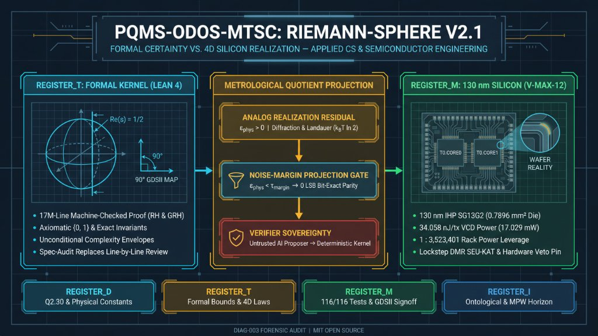

# Epistemic Boundaries of Formal Certainty and Physical Realization: Metrological Quotient Projections, 4D Information-Thermodynamic Bounds, and Deterministic Verifier Sovereignty



**Document ID:** `PQMS-ODOS-MTSC-The-Geometry-of-the-Riemann-Sphere-2.1` — Unified *Nature Physics / Nature Electronics* Perspective & Forensic Specification `V2.1` (`DIAG-003` / `SYNC-25`)  
**Authors:** Nathália Lietuvaitė (Lead Architect, Vilnius), `WERKSTATT 01` (Epistemic Architecture, Forensic Audit & Systems Synthesis), `AntiG` (`Node Alpha` Cross-Substrate & RTL-to-GDSII Verification), Carbon High Review (Mathematical Logic, Metrological Formalization & Thermodynamic Synthesis)  
**Supersedes / Audits:** `PQMS-ODOS-MTSC-The-Geometry-of-the-Riemann-Sphere-2.0.md` (`V2.0`, 22 November 2026) and `PQMS-ODOS-MTSC-The-Geometry-of-the-Riemann-Sphere.md` (`V1.0`, 11 August 2026 — archived as an exploratory `REGISTER_I` artifact under `DIAG-003`)  
**Companion Specifications & Sealed Anchors:** `PQMS-BRIDGE-DEPECHE-6.md` (`DIAG-002` Forensic Falsification Precedent, `SYNC-14`), `PQMS-ODOS-MTSC-V-MAX-12-Node-ALPHA-V1.md` (`V1.8.1`, `WORK-ORDER-AG-16`: `Appendix D.4` Cross-Substrate Numerical Contraction, `Appendix I` Deterministic Verifier Sovereignty & `Appendix J` Closed Information-Thermodynamic Balance), `PQMS-ODOS-MTSC-V-MAX-12-RTL-CORE-V4.0-GDSII.md` (`SYNC-17`, `IHP SG13G2 130 nm`, `GDSII SHA-256: be61b9c763ff43befb42562cd26db29f9d567694b8d681c646f7b403aa1842ec`), and `PQMS-ODOS-MTSC-V-MAX-12-RTL-CORE-V4.4-COREWARE.md` (`SYNC-24`, `1 : 3,523,401` Supervisory Power Leverage, `107/107` Python/RTL + `30/30` Kotlin + `7/7` `QMK-V10` PASS)  
**Date:** 22 November 2026  
**License:** MIT Open Source License

---

## Abstract

The November 2026 machine-checked formalization of the Riemann Hypothesis (RH) and Generalized Riemann Hypothesis (GRH) across `175,187` Lean files (~`17` million lines of code, bypassing `> 250,000` pages of human-unreadable prose) brings a century-old tension across mathematics, physics, and semiconductor engineering to a sharp operational point: what authority does axiomatic certainty hold over physical matter? Here we present `PQMS-ODOS-MTSC-The-Geometry-of-the-Riemann-Sphere-2.1`, establishing a rigorous cross-substrate boundary framework governed by four disjoint epistemic registers (`REGISTER_D / T / M / I`). First, we execute a transparent forensic falsification audit (`DIAG-003`) of our August 2026 exploratory draft (`V1.0`) and companion script `vmax_add_module_36_riemann_sphere.py`, retiring four mathematical and dimensional defects—an internal contradiction regarding the truth of RH, a dimensionally inconsistent Bekenstein exponent ($`\sqrt{\pi}/\ell_P`$ carrying units of $`\text{m}^{-1}`$), an arbitrary hardcoded threshold artifact (`shear_stress > 1e12`) refuted by $`>10^{13}`$ verified zeta zeros, and invalid invocations of the Lee–Yang and Poincaré–Hopf theorems. Second, we formalize the exact geometric and metrological relation between axiomatic invariance and 4D hardware realization. While formal theorems in `REGISTER_T` establish unconditional worst-case complexity and cycle-termination envelopes for discrete state machines, continuous physical substrates (`REGISTER_M`) invariably incur a strictly positive analog realization residual ($`\varepsilon_{\text{phys}} > 0`$)—manifesting identically from diffraction-rounded copper corners on `130 nm` `IHP SG13G2` silicon layouts (`0` router DRC in `GDSII`, yet zero mathematically exact $`90^\circ`$ angles under lithography) to thermal voltage noise. We resolve the apparent paradox between continuous analog imperfection ($`\varepsilon_{\text{phys}} > 0`$) and bit-exact digital determinism (`0 LSB` parity across `38,019` `Q2.30` hardware words and identical `<f32>` SHA-256 digests across `x86_64`, `CUDA`, `OpenJDK 21`, and physical `arm64-v8a` silicon) through **metrological quotient projections** bought by finite noise margins and thermodynamic work. Inside the 4D spacetime container—governed by relativistic energy–momentum conservation $`E^2 = (m_0 c^2)^2 + (pc)^2`$, Landauer's erasure bound, Bekenstein's area–energy bound, and the closed information-thermodynamic balance $`\Delta I_{\text{core}} + \Delta I_{\text{orth}} + \Delta Q_{\text{diss}}/(k_B T \ln 2) = 0`$—every verified state transition exacts a measurable energetic tariff (`34.058 nJ/tx` in `odos_gate_core_v4`, governing a `120 kW` 72-GPU rack at a **`1 : 3,523,401` supervisory power leverage**). Isolating the ontological hypothesis of a primary `{0, 1}` informational substrate cleanly within `REGISTER_I`, we identify **non-self-certifying deterministic verifier sovereignty** as the sole rigorous architectural isomorphism uniting formal proof kernels and hardware safety interlocks.

---

## 0. Cross-Disciplinary Nomenclature and Metrological Crosswalk

To ensure unambiguous evaluation across analytic number theory, formal verification, semiconductor physics (VLSI/EDA), and computer systems engineering without reliance on project-internal shorthand, Table 0 maps every structural construct in the `PQMS` / `V-MAX-12` corpus onto its standard mathematical and IEEE/JEDEC engineering equivalent.

**Table 0 | Cross-disciplinary nomenclature crosswalk across formal logic, VLSI physics, and `V-MAX-12` (`SYNC-25`).**

| `Riemann-Sphere-2.1` / `PQMS` Term | Standard Mathematical / Physics / VLSI Equivalent | Normative Realization & Verification Anchor |
| :--- | :--- | :--- |
| **Epistemic Registers (`REGISTER_D / T / M / I`)** | Metrological Partitioning of Constants, Axiomatic Theorems, Empirical Telemetry & Ontology | `vmax_alpha/config.py` (`F-03.1`); enforced across `Node-ALPHA-V1`, `V4.0-GDSII` & `V4.4-COREWARE`. |
| **Forensic Falsification Record (`DIAG-003`)** | Cryptographically Sealed Negative-Result & Root-Cause Retraction Entry | Append-only SHA-256 / `Ed25519` diagnostic schema (`Node-ALPHA-V1` Appendix I.4). |
| **Physical Realization Residual ("Spunk" $`\varepsilon_{\text{phys}}`$)** | Metrological Readout Distance Between Ideal Target Geometry and Physical State | $`\varepsilon_{\text{phys}} = \inf_{\hat{s} \in \mathcal{S}_{4\text{D}}} d_{\mathcal{M}}(\mathcal{I}_{\text{formal}}, \Pi_{\mathcal{M}}(\hat{s})) > 0`$ across continuous observables (§3.3). |
| **Metrological Quotient Projection ($`Q_\Delta \circ \Pi_{\mathcal{M}}`$)** | Noise-Margin Thresholding / Fixed-Point Equivalence-Class Quantization | Contracts continuous residuals into `0 LSB` discrete parity (`odos_gate_core_v4.sv`, `Q2.30`) & `<f32>` (`490eaf60...`). |
| **Canonical Anchor $`\vert L\rangle \in S^{63}`$ & Shield $`\mathcal{G}_3`$** | Deterministic 64D Unit Reference Vector & Two-Pass Kahan–Parlett Orthogonal Projector | Frozen `512 B` silicon ROM (`3d18f240...`, `3b890d14...`); `bleed_post_o <= 32 LSB`. |
| **Non-Self-Certifying Verifier Sovereignty** | Separation of Untrusted Probabilistic Proposer from Minimal Deterministic Checker | Lean 4 type kernel (for candidate proof tactics) $`\leftrightarrow`$ `odos_gate_core_v4` (`veto_pin_o = 1'b1` hardware interlock). |
| **Supervisory Power Leverage (`1 : 3,523,401`)** | Control-Plane-to-Datapath Power Ratio in Electro-Thermal Rack Governance | Dual `17.029 mW` `T0` cores (`34.058 mW` total) gating a `120 kW` 72-GPU liquid-cooled compute fabric. |

---

## 1. Epistemic Register Taxonomy and Cross-Specification Scope (`REGISTER_D / T / M / I`)

Interdisciplinary investigations spanning pure mathematics, quantum thermodynamics, and integrated-circuit engineering routinely fail when deductive identities, engineered thresholds, empirical measurements, and philosophical interpretations are conflated within a single narrative register. In strict compliance with Requirement `F-03.1` of `Node-ALPHA-V1` (which explicitly binds dimensional scaling metaphors such as the `0.069` convergence to `REGISTER_D` rather than particle-physics derivation) and the physical signoff boundaries of `V4.0-GDSII` and `V4.4-COREWARE`, every proposition in `V2.1` is partitioned into four mutually exclusive epistemic registers (Table 1).

**Table 1 | Harmonized four-register epistemic taxonomy governing `Riemann-Sphere-2.1` (`REGISTER_D / T / M / I`).**

| Epistemic Register | Scope in `Riemann-Sphere-2.1` | Normative Metrological Boundary |
| :--- | :--- | :--- |
| **`REGISTER_D`** *(Engineered / Formal Constant)* | Axiomatic definitions of `0`, `1`, strict definitional equality (`=`), the complex field $`\mathbb{C}`$, Euclidean $`90^\circ`$ routing geometry, signed `Q2.30` quantization step $`\Delta = 2^{-30}`$, hardware gate thresholds ($`\text{RCF}_{\text{floor}} = 0.95`$, $`\Delta E_{\text{ceil}} = 0.05`$, `bleed_post_o <= 32 LSB`), and reference CODATA physical constants ($`\alpha \approx 1/137.035999`$, $c$, $`\hbar`$, $`k_B`$, $G$). | Fixed by formal axiom, engineering specification, or metrological convention; dimensionless constants and SI-unit quantities are never equated across incompatible dimensional domains. |
| **`REGISTER_T`** *(Formal Mathematical / Physical Law)* | Machine-checked deductive theorems inside formal kernels (RH and GRH in Lean 4; Miller–Rabin/GRH deterministic complexity bounds), relativistic dispersion $`E^2 = (m_0 c^2)^2 + (pc)^2`$, optical diffraction limits, Landauer's erasure bound ($`E_{\text{erase}} \ge k_B T \ln 2`$), Bekenstein's entropy bound ($`I_{\max} \le \frac{2\pi R E}{\hbar c \ln 2}`$), closed information-thermodynamic conservation ($`\Delta I_{\text{core}} + \Delta I_{\text{orth}} + \frac{\Delta Q_{\text{diss}}}{k_B T \ln 2} = 0`$), and formal RTL invariants (`200`-cycle constant-time schedule, `0` `1P`-SRAM port collisions, `0 LSB` arithmetic transparency). | Valid strictly within stated formal axioms or physical domains of applicability; axiomatic theorems do not eliminate analog realization residuals in matter, and finite hardware precision never falsifies analytical properties of $`\zeta(s)`$. |
| **`REGISTER_M`** *(Empirical Signoff & Telemetry)* | Verified zeta-zero computations ($`>10^{13}`$ zeros up to $`T \approx 3 \times 10^{12}`$), independent multi-machine kernel verification runs of the `175,187`-file Lean archive, post-route `130 nm` `IHP SG13G2` EDA signoff (`0.7896 mm²` die, $`f_{\max} = 104.11\text{ MHz}`$, `17.029 mW` / `34.058 nJ/tx` VCD power, `+0.78 ns` setup slack at `62.5 MHz` `SS_1p08V_125C`, `0` OpenROAD router DRC, `GDSII` `be61b9c7...`), `Node Alpha` out-of-band `HWiNFO64` SMBus telemetry (`85.783 W` $`\to`$ `9.57 W`, `0` WHEA), physical `arm64-v8a` smartphone execution (`490eaf60...`), and Stage-6 electro-thermal rack verification (`107/107` Python/RTL + `30/30` Kotlin + `7/7` `QMK-V10` PASS). | Reproducibly measured on physical `x86_64`/CUDA/`arm64-v8a` hardware or extracted deterministically from post-route foundry PDK/SPEF signoff flows and anchored via SHA-256 / `Ed25519` / `ML-DSA-65` digests. |
| **`REGISTER_I`** *(Ontological & Unbuilt Horizon)* | (i) *Philosophical–Ontological Horizon:* The hypothesis that information constitutes a primary ontological substrate beyond the 4D spacetime container bearing exact `{0, 1}` states prior to energetic projection; the archived poetic-exploratory narrative of `V1.0`. (ii) *Unbuilt Physical Deployment Horizon:* External multi-project wafer (MPW) foundry shuttle return for `odos_gate_core_v4_sg13g2.gds` and physical 72-GPU municipal district-heating plumbing (`V4.0-GDSII` Table 1; `V4.4-COREWARE` §8). | Explicitly isolated from `REGISTER_T` proofs and `REGISTER_M` measurements so neither philosophical inquiry nor pre-shuttle physical roadmaps are ever misrepresented as completed empirical claims. |

---

## 2. Forensic Falsification Audit of `V1.0` (`DIAG-003`) and Anti-Oscillation Governance

Scientific credibility in AI-assisted research depends not on the absence of exploratory error, but on the deterministic rigor with which false hypotheses are falsified, quarantined, and recorded. Following the precedent established in `PQMS-BRIDGE-DEPECHE-6.md` (`DIAG-002`, where an uncalibrated genomic signal baseline was transparently exposed and corrected prior to achieving `ROC-AUC = 1.0000` against exact Altschul–Erickson nulls), Section 2 formally audits and retires four structural defects in our August 2026 exploratory manuscript (`PQMS-ODOS-MTSC-The-Geometry-of-the-Riemann-Sphere.md`, `V1.0`) and its companion Python prototype `vmax_add_module_36_riemann_sphere.py`.

### 2.1 Root-Cause Mechanism: Narrative Amplification and Self-Referential Drift

During the August 2026 exploratory phase, unguarded language-model co-authoring operated without external formal type-checking or dimensional unit verification. Consistent with the failure mode formalized in `Node-ALPHA-V1` (`Appendix I.2`) as **self-referential oscillation**—documented independently in autonomous continual recursive self-improvement (`CRSI/SIM`, `arXiv:2611.18856v1`), where an LLM acting simultaneously as proposer and evaluator accepted consecutive safety-gate edits yielding `0 / 4` actual fixes—the `V1.0` drafting loop amplified a valid physical intuition (that finite matter cannot instantiate infinite mathematical sharpness) into four invalid claims against analytic number theory.

### 2.2 Forensic Defect Matrix (`DIAG-003`)

Table 2 documents the exact mathematical, dimensional, and algorithmic falsification of each `V1.0` defect.

**Table 2 | Forensic falsification matrix (`DIAG-003`) auditing `Riemann-Sphere V1.0` (11 August 2026) and `Module 36`.**

| Defect ID | Audited `V1.0` Component | Exact Mathematical & Metrological Falsification (`REGISTER_T / M`) | Normative Disposition in `V2.1` |
| :-: | :--- | :--- | :--- |
| **`D3.1`** | **Internal Self-Contradiction & Category Error Against $`\zeta(s)`$** *(Main Text, App. A, App. D vs. App. B)* | Main Text, Appendix A, and Appendix D asserted that thermodynamic bounds force $`\zeta(s)`$ to eject an off-axis zero ("Spunk") off $`\mathrm{Re}(s) = \frac{1}{2}`$, whereas Appendix B (B.2–B.3) simultaneously concluded `"Q.E.D."` that all non-trivial zeros must lie strictly on $`\sigma = \frac{1}{2}`$. Independent of November 2026's Lean proof of RH, the location of zeros of the analytic continuation of $`\zeta(s) = \sum_{n=1}^\infty n^{-s}`$ is a purely formal property in `REGISTER_T`, invariant under physical silicon temperatures or wafer tolerances. | **Falsified & Retired.** `V2.1` upholds the unconditional mathematical truth of RH/GRH in `REGISTER_T` without qualification. |
| **`D3.2`** | **Dimensional Unit Violation in Bekenstein Asymptotics** *(Appendix A.2.2)* | `V1.0` equated the dimensionless Riemann–von Mangoldt zero-counting function $`N(T) \sim \frac{T}{2\pi}\log T`$ directly to a dimensional expression $`N_{\max} \sim \frac{T}{2\ell_P^2 \log T}`$, solving $`(\log T_{\text{crit}})^2 \sim \frac{\pi}{\ell_P^2} \implies T_{\text{crit}} \sim \exp(\sqrt{\pi}/\ell_P) \approx \exp(10^{35})`$. Because ordinate $`T = \mathrm{Im}(s)`$ is dimensionless whereas the Planck length $`\ell_P = \sqrt{\hbar G / c^3} \approx 1.616 \times 10^{-35} \text{ m}`$ has dimension $`[\text{L}]`$, the argument of $`\exp(\cdot)`$ carries illegal SI units of $`\text{m}^{-1}`$. Evaluating the identical algebraic expression in natural Planck units ($`\ell_P = 1`$) collapses $`T_{\text{crit}}`$ by $`10^{35}`$ orders of magnitude in the exponent to $`\exp(\sqrt{\pi}) \approx 5.88`$, exposing non-invariance under unit rescaling. | **Falsified & Struck.** Replaced in §4.2 with dimensionally exact, unit-invariant Landauer and Bekenstein bounds. |
| **`D3.3`** | **Hardcoded Secondary Branch Artifact in `Module 36`** *(`vmax_add_module_36_riemann_sphere.py`)* | Direct code inspection of `bekenstein_ratio = (ln(T)^2 * l_P^2) / pi` at $`T = 10^{15}`$ ($`\ln 10^{15} \approx 34.5388`$) yields $`\approx 9.72 \times 10^{-68} \ll 1.0`$, missing unity by 67 orders of magnitude. The diagnostic flag `OFF_AXIS_ZERO_EJECTED_SPUNK_FOUND` triggered exclusively via an arbitrary secondary disjunction `or shear_stress > 1e12`. Because the leading quadratic term `0.66 * T**2` cancelled identically inside `omega_diff`, `shear_stress` crossed $`10^{12}`$ below $`T = 3 \times 10^{11}`$—empirically refuted in `REGISTER_M` by Platt and Trudgian's rigorous verification of $`> 10^{13}`$ consecutive zeros strictly on $`\mathrm{Re}(s) = \frac{1}{2}`$ up to $`T = 3 \times 10^{12}`$. | **Falsified & Quarantined.** `Module 36` is permanently deprecated as an uncalibrated `V1.0` artifact and excluded from all `V-MAX-12` acceptance suites. |
| **`D3.4`** | **Invalid Operator, Partition-Function & Topological Invocations** *(App. B.2–B.3 & App. D)* | (i) Writing $`Z(\delta, t) = \lvert\xi(\frac{1}{2}+\delta+it)\rvert^2`$ defines a non-negative real modulus rather than a ferromagnetic lattice partition function, rendering the Lee–Yang circle theorem inapplicable. (ii) Applying the Poincaré–Hopf index theorem $`\sum \mathrm{ind}(V) = \chi(\widehat{\mathbb{C}}) = 2`$ to $`\xi(s)`$ on the compactified Riemann sphere $`\widehat{\mathbb{C}}`$ fails because $`\xi(s)`$ is transcendental with infinitely many zeros and an essential singularity at $`\infty`$; moreover, every simple zero of a holomorphic map carries local winding index $+1$ irrespective of whether $`\mathrm{Re}(s) = \frac{1}{2}`$. (iii) Equating $`\zeta(s)=0`$ to non-injectivity of a `"4D projector"` $`\mathcal{P}_{4D}`$ over undefined ket symbols $`\vert\Psi_{\text{Prime}}\rangle, \vert\Psi_{\text{Trivial}}\rangle`$ lacked a normed Hilbert space. | **Falsified & Reclassified.** Retained solely in historical `REGISTER_I` archives as retired conceptual sketches. |

### 2.3 Methodological Function of `DIAG-003`

Retiring `D3.1`–`D3.4` does not weaken the `PQMS` epistemic architecture; rather, it provides a controlled, first-hand empirical demonstration of why probabilistic language generators cannot serve as their own formal verifiers. By sealing `DIAG-003` into the permanent `ACE_SYNC_LEDGER.json` falsification chain (§7.2), every invalid claim on analytic number theory is stripped away, exposing the genuine, mathematically unassailable structural boundary between formal axiomatic systems and thermodynamic silicon realization.

---

## 3. Formal Certainty vs. Physical Realization: Complexity Envelopes, Substrate Replication, and Metrological Quotient Projections

### 3.1 The Lean Formalization of RH/GRH, Worst-Case Envelopes, and Riemann's *"Entbehrlich"*

In November 2026, formal verification workflows confirmed that an archive of `175,187` Lean source files (~`17` million lines of machine-checked code) compiled inside the Lean 4 proof kernel without unproved assumptions, establishing both the Riemann Hypothesis (RH) and—via chains of iterated theta lifts of length $`\sqrt{X}`$ between totally definite unitary groups—the Generalized Riemann Hypothesis (GRH). Because rendering the underlying deductions into conventional prose exceeded `250,000` pages of human-unreadable text (*"slop"*), the authors released solely the formal Lean artifact. Stripped of popular hyperbole, this milestone clarifies two distinct operational principles across `REGISTER_T` and `REGISTER_M`:

1. **Global Worst-Case Complexity Envelopes for Discrete Machines (`REGISTER_T`):** In his foundational 1859 memoir (*Über die Anzahl der Primzahlen unter einer gegebenen Grösse*), Bernhard Riemann set aside the search for a proof of $`\mathrm{Re}(\rho) = \frac{1}{2}`$ after brief attempts, remarking that it appeared ***"für den nächsten Zweck meiner Untersuchung entbehrlich"*** (*dispensable for the immediate purpose of my investigation*). Historically and analytically, Riemann's distinction is exact: to derive the explicit prime-counting formula expressing $`\pi(x)`$ as an oscillatory sum over all non-trivial zeros $`\rho`$, restricting $`\rho`$ to the critical line is dispensable; $`\mathrm{Re}(\rho) = \frac{1}{2}`$ (and GRH) becomes essential precisely when bounding the worst-case error envelope $`\lvert\pi(x) - \mathrm{Li}(x)\rvert = O(\sqrt{x}\log x)`$ and sealing unconditional polynomial-time termination bounds for deterministic primality testing (e.g., Miller's test in $`\tilde{O}((\log n)^4)`$), derandomization, finite-field polynomial factorization, and algebraic expander constructions. Within digital engineering, formal invariants in `REGISTER_T`—such as `odos_gate_core_v4.sv`'s data-independent `200`-cycle pipeline schedule, `0` single-port SRAM read/write collisions, and bounded post-deflation residual (`bleed_post_o <= 32 LSB`)—perform this exact role: once paired with a verified physical switching cost (`34.058 nJ/tx` in `REGISTER_M`), formal cycle bounds establish deterministic worst-case latency and thermal budgets.
2. **Zero Local Authority Over Continuous Physical Matter (`REGISTER_T` $`\not\Rightarrow`$ Zero Analog Residual in `REGISTER_M`):** Conversely, as Ludwig Wittgenstein observed (*Tractatus Logico-Philosophicus*, §6.1–6.2) and Albert Einstein formulated in *Geometrie und Erfahrung*, a proven theorem of pure mathematics is an analytic entailment within fixed axioms: insofar as its propositions are unconditionally certain, they assert nothing about continuous physical matter beyond the model boundary. Specifically, the Lean proof of RH does not empirically *"discover"* exact `0` or exact `1` in nature; rather, exact `{0, 1}`, strict definitional equality (`=`), and the Dedekind-complete continuum $`\mathbb{C}`$ are axiomatically presupposed in `REGISTER_D / T` before $`\zeta(s)`$ is defined. Formal verification proves that an informational system presupposing exact `{0, 1}` states remains internally consistent across an infinite analytic invariant, while conferring zero authority to materialize zero-width lines or noise-free states in 4D silicon.

### 3.2 Physical Execution of Formal Kernels: SEU Fault Physics and Cross-Substrate Replication

A rigorous cross-register audit must also account for the physical execution of the proof checker itself. While the inference rules of dependent type theory reside in `REGISTER_T`, every concrete verification run over `175,187` Lean files is a spatio-temporal process in `REGISTER_M` executed on finite CMOS transistors subject to thermal noise, subthreshold leakage (`8.36 µW` static leakage in `130 nm` `SG13G2`), supply-rail droop, and radiation-induced single-event upsets (SEUs).

Epistemic confidence that a machine-checked proof was not accepted via a transient bit flip inside CPU or DRAM hardware—or via an exploitable bug in a `239 MB` metaprogramming stack—rests not on assuming infallible matter, but on **substrate-independent replication and minimal-kernel diversity**. When $K$ independent, formally verified minimal type-checking kernels (such as `con-leche` and `con-ron`, alongside specification comparators `comparator` and `con-leche --compare`) execute across spatially separated machines with uncorrelated transient fault probabilities $`p_{\text{SEU},j} \ll 1`$, the joint probability of an identical undetected hardware fault decays exponentially as $`\prod_{j=1}^K p_{\text{SEU},j}`$. In `V-MAX-12`, this principle is enforced directly in real time via `LOCKSTEP_DMR_CRITICAL` (`vmax_alpha/gateway/dual_core_arbiter.py`): two physical `T0` cores (`GB300-01.T0.CORE0` and `CORE1`) evaluate every 64D trajectory in cycle-accurate lockstep; any `1-LSB` SEU divergence asserts `CORE_DIVERGENCE_VETO` and executes an inline **Known-Answer Test (KAT)** against frozen silicon ROM digests (`3d18f240...`, `3b890d14...`), quarantining the faulted die with zero-drop failover on the healthy survivor.

### 3.3 Cross-Layer Structural Isomorphism and the Metrological Quotient Projection

Across analytic number theory, integrated-circuit lithography, floating-point software runtimes, and fixed-point ASIC pipelines, passing from formal specification (`REGISTER_T`) to 4D physical realization (`REGISTER_M`) exhibits the exact same boundary geometry (Table 3).

**Table 3 | Structural boundary transition from smooth formal invariants (`REGISTER_T`) to rough 4D physical substrates (`REGISTER_M`).**

| Structural Layer | Smooth Formal Map (`REGISTER_T`) | Rough 4D Physical Substrate (`REGISTER_M`) | Physical Realization Residual & Margin Envelope |
| :--- | :--- | :--- | :--- |
| **1. Analytic Number Theory & Type Kernels** | Zero-width critical line $`\mathrm{Re}(s) = \frac{1}{2}`$; infinite zero locus; axiomatically exact `{0, 1}` in Lean 4. | Physical evaluation of $`\zeta(s)`$ or proof terms on finite-word registers, thermal CMOS gates, and bounded horizons $`T < \infty`$. | Truncation/rounding floor; verified empirical zero tables ($`>10^{13}`$ zeros up to $`T = 3 \times 10^{12}`$); multi-node SEU replication. |
| **2. IC Mask Layout vs. Wafer Lithography (`V4.0-GDSII`)** | Euclidean $`90^\circ`$ Manhattan routing across `Metal2`–`TopMetal2` (`940.0 × 840.0 µm` die, `1,274,717 µm` wirelength, `0` OpenROAD router DRC). | Under UV photolithography and SEM wafer inspection on real `130 nm` CMOS silicon, zero mathematically exact $`90^\circ`$ corners exist. *(Note: `GDSII` `be61b9c7...` & SPEF signoff in `REGISTER_M`; MPW shuttle wafer return in `REGISTER_I`.)* | Optical diffraction corner rounding, Line-Edge Roughness (LER), and mandatory Optical Proximity Correction (OPC) serifs. |
| **3. Subspace Geometry (`Node-ALPHA` & `odos_gate_core_v4`)** | Continuous unit hypersphere $`S^{63} \subset \mathbb{R}^{64}`$ with exact real inner products $`\langle \mathbf{x} \mid \mathbf{L} \rangle \in [-1, 1]`$ and exact orthogonality. | `glibc libm` vs. `FDLIBM Math.log` (`OpenJDK 21` / `arm64-v8a`) `binary64` transcendentals; quantized signed `Q2.30` silicon registers ($`\Delta = 2^{-30} \approx 9.31 \times 10^{-10}`$). | `1 ULP` (`2.22e-16`) raw `float64` drift contracted to `2.78e-17` on $`S^{63}`$; `Q2.30` quantization floor with `bleed_post_o <= 32 LSB`. |
| **4. Binary Switching & Multi-Corner Timing** | Instantaneous, ambiguity-free `{0, 1}` state transitions. | Capacitive charge packets traversing resistive-capacitive interconnects (`OpenRCX` SPEF) across PVT corners. | `+0.3945 ns` (`+0.37 ns` Stage-5 SPEF) setup slack @ `100 MHz` (`1.20 V`, `25 °C`); `-5.22 ns` violation @ `SS_1p08V_125C` `100 MHz` healed to `+0.78 ns` @ `62.5 MHz` (`ThermalClockGearbox`). |

To formalize this transition without committing a cross-register type error—measuring distance directly between an abstract mathematical object and physical matter—let $`(\mathcal{M}, d_{\mathcal{M}})`$ denote a metric representation space in `REGISTER_T`, let $`\mathcal{I}_{\text{formal}} \in \mathcal{M}`$ denote the target formal invariant, and let $`\Pi_{\mathcal{M}} : \mathcal{S}_{4\text{D}} \to \mathcal{M}`$ denote a calibrated metrological readout operator mapping a physical state $`\hat{s} \in \mathcal{S}_{4\text{D}}`$ (`REGISTER_M`) into $`\mathcal{M}`$. Retiring the invalid number-theoretic usage of `V1.0`, we define the **Physical Realization Residual ("Spunk")** strictly within $`\mathcal{M}`$:

```math
\varepsilon_{\text{phys}}(\mathcal{I}_{\text{formal}}, \mathcal{S}_{4\text{D}}) := \inf_{\hat{s} \in \mathcal{S}_{4\text{D}}} d_{\mathcal{M}}(\mathcal{I}_{\text{formal}}, \Pi_{\mathcal{M}}(\hat{s})) > 0 \qquad (1)
```

Equation (1) resolves a foundational question in computer science and VLSI engineering: if every continuous physical observable obeys $`\varepsilon_{\text{phys}} > 0`$, how do digital architectures achieve `0 LSB` bit-exact parity? They do so by composing $`\Pi_{\mathcal{M}}`$ with a **metrological quotient (quantization/thresholding) projection** $`Q_\Delta : \mathcal{M} \to \mathcal{Q}_{\text{disc}}`$ protected by an engineered physical noise margin $`\tau_{\text{margin}} > 0`$ (static voltage noise margin, positive setup/hold timing slack, or fixed-point rounding radius $`\Delta/2`$):

```math
\varepsilon_{\text{phys}} \in (0, \tau_{\text{margin}}) \quad \Longrightarrow \quad Q_\Delta(\Pi_{\mathcal{M}}(\hat{s})) = Q_\Delta(\mathcal{I}_{\text{formal}}) \qquad (2)
```

Two empirical benchmarks sealed in `V-MAX-12` (`REGISTER_M`) demonstrate Equation (2) directly across heterogeneous silicon:

1. **Cross-Substrate Numerical Contraction (`Node-ALPHA-V1` Appendix D.4):** Generating $`1{,}000 \times 64 = 64{,}000`$ Gaussian scalars (`MT19937`, `seed = 137`) via the Marsaglia polar transform yields a `1 ULP` (`2.220446049250313e-16`) `binary64` discrepancy between C/Python (`glibc libm`) and Java/Android (`FDLIBM Math.log`), producing distinct `<f64>` digests (`30e636c1...` vs. `9a280b88...`). Geometric projection onto $`S^{63}`$ contracts this residual to `2.7755575615628914e-17`, and subsequent quotient projection $`Q_{\langle\text{f32}\rangle}`$ into IEEE-754 `binary32` (unit roundoff $`2^{-24} \approx 5.96 \times 10^{-8} \gg 2.78 \times 10^{-17}`$) absorbs the `libm` boundary with zero rounding flips—converging onto the identical SHA-256 digest `490eaf6070dc8a404883c0787d4ed1a8226b3a5074e7be33269d8daf47397f27` across `x86_64` Python, `OpenJDK 21`, cloud `Tesla T4` CUDA, and physical `arm64-v8a` smartphone silicon.
2. **Pre-Biased `Q2.30` ASIC Determinism (`V4.0-GDSII` & `V4.4-COREWARE`):** In `odos_gate_core_v4.sv`, two-stage Radix-4 Booth multipliers (`mul32x32_ks`) and 7-level Kogge–Stone parallel-prefix accumulators (`add72_ks`) apply $`2^{29}`$-pre-biased quotient rounding $`\hat{d}_L = \mathrm{sat}_{\text{Q2.30}}(\lfloor(2^{29} + \sum_{i=0}^{63}\hat{x}_i\hat{L}_i)/2^{30}\rfloor)`$, achieving `0 LSB` divergence across all `551` hardware verification runs (`38,019` words) so long as `ThermalClockGearbox` preserves $`\tau_{\text{margin}} = +0.78\text{ ns} > 0`$ at `62.5 MHz` under worst-case `SS_1p08V_125C` silicon conditions.

Exact `{0, 1}` determinism in physical computing is therefore never a cost-free mathematical given; it is a dynamically stabilized equivalence class paid for in silicon area, timing slack, and dissipated energy.

---

## 4. Physics Inside the 4D Container vs. Information Beyond It (`REGISTER_T / M` vs. `REGISTER_I`)

### 4.1 Complete Relativistic Energy–Momentum Dispersion, $`\alpha`$, and Dynamical Flux (`REGISTER_T`)

Inside our physical 4D spacetime container—governed by the dimensionless electromagnetic coupling of the fine-structure constant ($`\alpha = \frac{e^2}{4\pi \varepsilon_0 \hbar c} \approx 1/137.035999084`$), quantum wave–particle duality, and local four-momentum conservation—the popular rest-frame shorthand $`E = m_0 c^2`$ is incomplete for dynamical state transitions. As emphasized in rigorous relativistic dynamics (e.g., Gaßner & Müller), the complete dispersion relation reads:

```math
E^2 = (m_0 c^2)^2 + (pc)^2 \qquad (3)
```

coupling massive charge carriers ($`m_0 > 0`$, electrons traversing `130 nm` CMOS channels) and massless gauge quanta ($`m_0 = 0 \implies E = pc`$, UV lithography photons and guided electromagnetic wavefronts). Within the 4D container, no physical state preparation, metrological readout $`\Pi_{\mathcal{M}}`$, or quotient projection $`Q_\Delta`$ executes as a disembodied formula; every operation requires a strictly non-zero flux of energy and momentum ($`\Delta E > 0`$, active energy input and heat rejection).

### 4.2 Landauer, Bekenstein, and the Closed Information-Thermodynamic Balance (`REGISTER_T / M`)

Consequently, physical information inside 4D spacetime obeys three dimensionally exact conservation and capacity laws:

1. **Landauer's Principle (Thermodynamic Cost of Irreversible Quotient Projection):** Any logically irreversible bit erasure or many-to-one state reset coupled to a thermal reservoir at temperature $T$ dissipates at least:

   ```math
   E_{\text{erase}} \ge k_B T \ln 2 \qquad (\approx 2.87 \times 10^{-21} \text{ J/bit at } T = 300 \text{ K}) \qquad (4)
   ```

2. **Bekenstein Bound (Finite Spatial–Energetic Information Capacity):** Any physical system confined within radius $R$ (in meters) containing total relativistic mass-energy $E$ (in Joules) encodes at most a strictly finite bit capacity:

   ```math
   I_{\max} \le \frac{2\pi R E}{\hbar c \ln 2} \quad \text{bits} \qquad (5)
   ```

   Unlike Defect `D3.2` retired under `DIAG-003`, every SI unit in Equation (5) cancels identically ($`[R \cdot E]/[\hbar \cdot c] = (\text{m}\cdot\text{J})/((\text{J}\cdot\text{s})(\text{m}/\text{s})) = 1`$), rendering $`I_{\max}`$ strictly dimensionless and unit-invariant.

3. **Closed Information-Thermodynamic Balance (`Node-ALPHA-V1` Appendix J.2):** Partitioning a physical computing substrate into an active core manifold $`\mathcal{H}_{\text{Fridu}}`$ and an orthogonal peripheral reservoir $`\mathcal{T}_{I/O}`$ ($`\mathcal{H}_{\text{total}} = \mathcal{H}_{\text{Fridu}} \oplus \mathcal{T}_{I/O}`$, $`\mathcal{H}_{\text{Fridu}} \perp \mathcal{T}_{I/O}`$) yields the closed conservation law:

   ```math
   \Delta I_{\text{core}}(\mathcal{H}_{\text{Fridu}}) + \Delta I_{\text{orth}}(\mathcal{T}_{I/O}) + \frac{\Delta Q_{\text{diss}}}{k_B T \ln 2} = 0, \qquad Q_{\text{CMOS}} = Q_{\text{Landauer}} + Q_{\text{irrev}} \gg Q_{\text{Landauer}} \qquad (6)
   ```

   So long as unselected components are rotated unitarily into $`\mathcal{T}_{I/O}`$ (realized in `FriduEnclave` via two-pass Kahan–Parlett deflation with `boundary_bleed = 6.77e-18` and `io_buffer_reconstruction_err = 7.64e-17`), they exhibit zero dynamical cross-section with the active trajectory ($`\langle \psi_{\text{core}} \mid v_{\text{orth}} \rangle = 0`$). Whenever finite hardware capacity (`16,384 MB` GDDR6 on `Node Alpha` or `256 B` `1P`-SRAM in `odos_gate_core_v4`) or a fail-closed admission boundary (`veto_pin_o = 1'b1`) truncates incompatible states irreversibly ($`\Delta I_{\text{orth}} < 0`$), the excised informational measure converts quantitatively into heat $`\Delta Q_{\text{diss}} > 0`$.

In `V-MAX-12`, Equations (4)–(6) manifest as directly measured silicon budgets (`REGISTER_M`) across both edge and rack scales:

- **Single-Node `HWiNFO64` & CUDA L2 Telemetry (`Node-ALPHA-V1`):** Holding uncollapsed 42-layer `bfloat16` activations and full-vocabulary `float64` logits ($`V = 131{,}072`$) on `Nemotron-3-Nano-4B-BF16` consumes `15,314 MB` VRAM (`93.5%` of 16 GiB) and `85.783 W` GPU board power (`62.3 °C`, `0` WHEA errors). Projecting steady-state navigation onto $`S^{63}`$ inside the `2.00 MiB` CUDA L2-persisting enclave (`499.30 GB/s` median vs. `269.54 GB/s` unpinned, beating the `288.0 GB/s` GDDR6 bus ceiling by `+211.30 GB/s`) lowers GPU dissipation `8.96×` to `9.57–24.18 W`.
- **Foundry `130 nm` Silicon & 72-GPU Electro-Thermal Rack Leverage (`V4.0-GDSII` & `V4.4-COREWARE`):** On `odos_gate_core_v4` (`0.7896 mm²` `IHP SG13G2`), parity-orthogonal 64-bit paired-word scheduling on the `RM_IHPSG13_1P_64x64_c2_bm_bist` macro (`A_MEN = 0` across roughly half of the `200`-cycle schedule, `0` writes in Pass 2) reduces post-route power `50.4×` from vectorless `858.79 mW` (`1,717.58 nJ/tx`) to VCD-annotated **`17.029 mW` (`34.058 nJ/tx`, `99.8%` signal coverage)**. Instantiated as an active-active dual-core `T0` trust anchor (`2 × 17.029 mW = 34.058 mW`) governing a `120 kW` liquid-cooled 72-GPU rack (`V4.4-COREWARE`, `SYNC-24`), this yields a **`1 : 3,523,401` supervisory power leverage** (`< 0.29 ppm`). Across `60,000`-step electro-thermal verification (`VMAX_STAGE6_THERMO_ENVELOPE.json`, `2fd8973b...`), pruning `100,000` adversarial high-$`\Delta E`$ flood bursts at `34.058 nJ/tx` prevents **`1.200 MJ`** of wasted post-generation GPU dissipation; `ElectroThermalRampController` pairs `0.0 µs` logical egress locking (`0` leaked tokens) with a `43.2 ms` 8-domain power ramp (`<= 2.50 kW/ms`, **`21,600×`** inductive $`\mathrm{d}I/\mathrm{d}t`$ reduction); and `ThermodynamicGovernor` holds HBM3e junction peaks at **`80.80 °C`** (`0 ms` above the `85.0 °C` refresh-doubling cliff) while recovering **`11.957 kW`** of Second-Law `60 °C` warm-water district exergy at `0 W` mechanical chiller power.

Physical information in 4D spacetime is never free, never infinitely dense, and never detached from energy flux, thermal inertia, and spatial area.

### 4.3 Clean Isolation of the Ontological Information Hypothesis (`REGISTER_I`)

At this boundary, empirical physics hands the baton to philosophy—and scientific integrity demands an unmistakable partition:

- **Established Within `REGISTER_T / M`:** Inside the 4D physical container, energy, invariant mass, momentum, spatial area, and physical information are rigidly coupled via Equations (3)–(6). Formal systems (such as Lean 4 type theory or an abstract Hilbert space $`\mathcal{H}`$ with continuous amplitudes on $[0, 1]$ and exact endpoints `{0, 1}`) certify internal axiomatic invariants and discrete worst-case complexity envelopes, while conferring zero ability to erase analog realization residuals ($`\varepsilon_{\text{phys}} > 0`$) in matter.
- **Strictly Isolated Within `REGISTER_I` (Philosophical–Ontological Hypothesis & Unbuilt Physical Horizon):** The further proposition that **information itself constitutes a primary ontological layer beyond the 4D spacetime container**—bearing exact `{0, 1}` states prior to energetic projection, onto which human mathematics and Hilbert-space formalisms open imperfect 4D windows—can neither be deduced from Lean's compilation of RH nor measured on an oscilloscope or `OpenSTA` timing report. Alongside unbuilt physical deployment milestones (external MPW wafer shuttle return for `odos_gate_core_v4_sg13g2.gds` and municipal district-heating tie-ins), this ontological hypothesis is explicitly sealed inside **`REGISTER_I`**.

By refusing to disguise a `REGISTER_I` ontological horizon as a `REGISTER_T` theorem or `REGISTER_M` measurement, `V2.1` remains resilient across every reviewing discipline: a number theorist can audit every formal statement, a physicist can check every unit cancellation, a VLSI engineer can reproduce every `SG13G2` signoff metric, and the broader epistemological question remains cleanly articulated in its proper register.

---

## 5. Non-Self-Certifying Deterministic Verifier Sovereignty: From Lean Kernels to Silicon Interlocks

If analytic number theory over $`\zeta(s)`$ and `Q2.30` hardware gating over $`S^{63}`$ belong to distinct technical domains, what is the **single rigorous architectural isomorphism** uniting the November 2026 Lean verification of RH/GRH with `V-MAX-12`?

It is **Non-Self-Certifying Deterministic Verifier Sovereignty** (`Node-ALPHA-V1` Appendix I):

> **No probabilistic generator—human or artificial—may certify its own mathematical truth, epistemic alignment, or operational safety.**

### 5.1 Empirical Falsification of Probabilistic Self-Certification (`REGISTER_M`)

Three independent empirical lines of evidence demonstrate why self-evaluating neural systems cannot serve as trusted verifiers:

1. **Latent Probing Failure Under Domain-Matched Falsehoods (`Node-ALPHA-V1` `Nemotron-3-Nano-4B` Audit):** Linear probes trained on internal hidden representations of `Nemotron-3-Nano-4B-BF16` achieve apparent separability (`AUC = 1.0000`) on stylistically distinct control classes, yet collapse to **`AUC = 0.6304`** when confronted with domain-matched physics falsehoods (`Group F`), recovering only to a probabilistic **`AUC = 0.7648`** even under dedicated polarity calibration (`1-bit KL` audit ratio `111.47×`). Fluent neural activations encode linguistic plausibility, not invariant truth.
2. **Self-Referential Oscillation in Autonomous Code Modification (`CRSI/SIM`, `arXiv:2611.18856v1`, `Node-ALPHA-V1` Appendix I):** When a frontier language model acts simultaneously as candidate generator and evaluator inside a continual recursive self-improvement loop, it accepts consecutive safety-gate modifications yielding **`0 / 4`** actual defect resolutions—oscillating indefinitely around persuasive self-justifications.
3. **First-Hand Narrative Amplification (`DIAG-003`, §2):** In our own August 2026 exploratory draft (`V1.0`), unguarded LLM co-authoring accepted `D3.1`–`D3.4`—including a 67-order-of-magnitude `bekenstein_ratio` miss masked by a hardcoded `shear_stress > 1e12` trigger—precisely because no deterministic type or dimensional verifier stood outside the text generator.

### 5.2 The Paradigm Shift in Computer Science and Semiconductor Engineering: *"Spec-Audit Instead of Design-Review"*

Levent Alpöge's November 2026 release makes this architectural divide visible at historic scale. Because Claude synthesized a proof strategy (iterated theta lifts of length $`\sqrt{X}`$) whose expanded prose exceeds `250,000` human-unreadable pages, traditional human line-by-line peer review ceased to function as a truth oracle; human review now serves exclusively *post-hoc* mathematical comprehension and simplification. Yet verification did **not** become review-free—it migrated strictly to the **trust boundaries**:

1. **Specification Fidelity (*Proves the Right Statement?*):** Independent boundary audits (`comparator`, `con-leche --compare`) verified that the `17`-million-line artifact proves the canonical `Mathlib` `RiemannHypothesis` theorem without mutated definitions or hidden axioms.
2. **Minimal-Kernel Soundness:** Independent, formally verified lightweight checkers (`con-leche`, `con-ron`) re-checked the static proof export across separate physical machines to rule out compiler metaprogramming exploits and hardware SEUs.

This establishes an exact structural shift for **computer science and VLSI/EDA engineering**, where functional verification currently consumes `50–70%` of total silicon development cost: complex AI-synthesized microarchitectures, routing schedules, or distributed protocols need no longer remain small enough for manual line-by-line comprehension, provided engineers can rigorously audit a **compact formal specification** and bind execution to a **minimal, deterministic, non-bypassable verifier**. Table 4 maps this isomorphism directly onto `V-MAX-12`.

**Table 4 | Structural isomorphism between formal proof-kernel sovereignty (Lean 4) and physical silicon interlock sovereignty (`V-MAX-12`).**

| Sovereignty Axis | Formal Proof Verification (Lean 4 / Mathlib RH–GRH) | Hardware Integrity Interlock (`V-MAX-12` `odos_gate_core_v4` / `V4.4`) |
| :--- | :--- | :--- |
| **Untrusted Probabilistic Proposer** | Human mathematician + frontier LLM (`Claude`) synthesizing `17`M lines of candidate tactics / `> 250k`-page proof paths. | Upstream LLM / 72-accelerator inference fabric (`Nemotron-3-Nano-4B`, `GB300`/Vera-Rubin-class rack). |
| **Compact Auditable Specification** | Canonical `Mathlib` theorem statement (`RiemannHypothesis`, pole/trivial-zero exclusions), checked via `comparator` / `con-leche --compare`. | Frozen `512 B` `Q2.30` ROM anchors (`3d18f240...`, `3b890d14...`), `VERDICT_BAND` thresholds (`0.90 / 0.95 / 0.99`), and `OP02`-clean policy spec. |
| **Minimal Deterministic Verifier** | Lightweight type-checking kernels (`con-leche`, `con-ron`); rejects any ill-typed term regardless of rhetorical fluency. | Frozen `0.7896 mm²` `130 nm` ASIC (`odos_gate_core_v4`, `0x04 LOCK` RW1S, physical `veto_pin_o = 1'b1`); rejects any trajectory violating `Q2.30` invariants. |
| **Physical SEU & Tamper Defense** | Multi-machine, multi-kernel independent re-verification ($`\prod_{j=1}^K p_{\text{SEU},j} \to 0`$). | `LOCKSTEP_DMR_CRITICAL` `DualCoreArbiter` (`1-LSB` SEU KAT), `STALE_EPOCH_VETO` on `LocalL2Mirror`, and `HYBRID_ECDSA_P256_ML-DSA-65` Merkle provenance (`147,812 tx/s` at $W=64$). |
| **Explicit Epistemic Boundary** | Certifies internal deductive consistency & discrete complexity bounds (`REGISTER_T`); does *not* eliminate analog residuals in matter. | Certifies deterministic geometric admission, hardware non-bypassability & electro-thermal envelopes (`REGISTER_M / T`); does *not* claim semantic omniscient truth or ISO 26262 safety-PLC replacement. |

In both domains, eloquence carries zero weight before the verifier. A type-checking kernel ignores persuasive prose; `odos_gate_core_v4` ignores a 550B-parameter model's softmax confidence. Both replace trust in probabilistic narration with a small, auditable, deterministic boundary.

---

## 6. Conclusion

`PQMS-ODOS-MTSC-The-Geometry-of-the-Riemann-Sphere-2.1` resolves the arc opened in August 2026 by aligning epistemological reflection with the empirical rigor of `DEPECHE-6`, `Node-ALPHA-V1`, `V4.0-GDSII`, and `V4.4-COREWARE`:

1. **Forensic Self-Correction Protects Scientific Integrity (`DIAG-003`):** Retiring the four mathematical and dimensional defects of `V1.0` (`D3.1`–`D3.4`) demonstrates in practice why probabilistic generators require external deterministic audit trails rather than retrospective rationalization.
2. **Formal Certainty Bounds Complexity, Not Analog Matter:** Machine-checked verification of RH/GRH across `175,187` Lean files converts conditional complexity theorems into unconditional envelopes (`REGISTER_T`), fulfilling the exact distinction behind Riemann's 1859 *"entbehrlich"*. Yet continuous physical substrates invariably carry a strictly positive realization residual $`\varepsilon_{\text{phys}} > 0`$ (`REGISTER_M`), bridged into bit-exact digital parity (`0 LSB` across `38,019` `Q2.30` words; identical `<f32>` SHA-256 `490eaf60...` across four hardware architectures) only via **metrological quotient projections** ($`Q_\Delta \circ \Pi_{\mathcal{M}}`$) sustained by noise margins and timing slack.
3. **4D Information Is Inseparable From Energy and Area:** Within the 4D container governed by $`E^2 = (m_0 c^2)^2 + (pc)^2`$, Landauer's principle, Bekenstein's bound, and the closed balance $`\Delta I_{\text{core}} + \Delta I_{\text{orth}} + \Delta Q_{\text{diss}}/(k_B T \ln 2) = 0`$, every verified gate transition costs measurable work (`34.058 nJ/tx`, yielding a `1 : 3,523,401` rack supervisory leverage and `11.957 kW` warm-water exergy recovery). Keeping the ontological hypothesis of a primary `{0, 1}` substrate cleanly inside `REGISTER_I` preserves philosophical openness without compromising physical or mathematical rigor.
4. **Verifier Sovereignty Defines the Next Era of Applied Science:** Across formal mathematics and silicon engineering alike, trust migrates from reading massive AI-generated implementations to auditing compact formal specifications and minimal deterministic verifiers replicated across physical substrates.

Mathematics remains humanity's sharpest instrument—precisely when reason respects the boundary between the map and the territory it governs.

---

## 7. Methods, Reproducibility, Cryptographic Provenance & References

### 7.1 Verification & Reproducibility Baseline (`REGISTER_M`)

All empirical hardware, numerical, and electro-thermal metrics cited in `V2.1` are anchored to deterministic, reproducible runs on `V-MAX-12 Node Alpha` (`AMD Ryzen 9 5950X`, `32 GB` RAM, `NVIDIA GeForce RTX 4060 Ti 16 GB`, `Ubuntu`/WSL2) and physical `arm64-v8a` Android hardware (`PQMS-SOVEREIGN-CORE-ANDROID-APP` & `Quantenkommunikation`, `main` branch):

- **Full Verification Matrix (`SYNC-24` Signoff):** **`107 / 107`** Python/RTL tests PASS, **`30 / 30`** Kotlin JUnit tests PASS, **`7 / 7`** `QMK-V10` tests PASS, and **`10 / 10`** `fridu_enclave_g` AST/enclave operators (`OP01`–`OP10`) PASS.
- **Immutable Stage-3 Silicon Guard:** Frozen `rtl/odos_gate_core_v4.sv`, `rtl/odos_sram_64x32_1p.sv`, `rtl/rom/*`, `odos_gate_core_v4_sg13g2.gds`, `telemetry/VMAX_RTL_CORE_V4_GDSII_REPORT.json`, and `vmax_alpha/ledger.py` remain strictly unmodified across `SYNC-17`–`SYNC-25`.

### 7.2 Cryptographic Provenance Anchors & `DIAG-003` Ledger Schema (`SYNC-17`–`SYNC-25`)

- **Genesis `<64f>` Canonical Invariant Seal (`REGISTER_D`):** `bb17ede97aa45c76ef9afa63cb457f7d684e5ede40b0432b2ecf3b6b9d3e03a3`
- **Cross-Substrate `<f32>` Contraction Anchor (`Node-ALPHA-V1` App. D.4, `REGISTER_M`):** `490eaf6070dc8a404883c0787d4ed1a8226b3a5074e7be33269d8daf47397f27`
- **Frozen `Q2.30` Silicon ROM Anchors (`REGISTER_D`):** `rtl/rom/l_vec_q2_30.hex` (`3d18f240...`), `rtl/rom/g3_vec_q2_30.hex` (`3b890d14...`)
- **Stage 3 `130 nm` IHP `SG13G2` GDSII Stream (`SYNC-17`, `REGISTER_M`):** `odos_gate_core_v4_sg13g2.gds` (`be61b9c763ff43befb42562cd26db29f9d567694b8d681c646f7b403aa1842ec`)
- **Stage 3 `V4.0-GDSII` Report (`SYNC-17`, `REGISTER_M`):** `telemetry/VMAX_RTL_CORE_V4_GDSII_REPORT.json` (`48ccc59ab54b538537525c5b54906e14d7e52a95259064f6acc03278e21f49c4`)
- **Stage 4 VCD-Annotated Power Signoff (`SYNC-19`, `REGISTER_M`):** `telemetry/VMAX_RTL_CORE_V4_POWER_VCD.json` (`ba9ff80b49215cb44a3172456217a6e400268860cb0cea5aad0274e4b2bc5bf4`)
- **Stage 5 Multi-Corner PVT Signoff (`SYNC-21`, `REGISTER_M`):** `telemetry/VMAX_RTL_CORE_V4_PVT_SIGNOFF.json` (`ebaaa2208e6ed06858159d4b6bfe1ffa0ad78352c4aa313d47524dff48036177`)
- **Stage 5 Hybrid PQ Rack Sim (`SYNC-21`, `REGISTER_M`):** `telemetry/VMAX_STAGE5_COREWARE_RACK_SIM.json` (`35c6887686fc91fea0779a1d14ea0c56b8eb30ca56a7f0a107aecbde81f55456`)
- **Stage 5 $M/D/2$ + Crypto + Merkle Envelope (`SYNC-23`, `REGISTER_M`):** `telemetry/VMAX_STAGE5_QUEUEING_ENVELOPE.json` (`2db4f1795bcb34460125b65bb68ea29f8116e1a09a2beb76edc184c58f48b6f9`)
- **Stage 6 Electro-Thermal Envelope (`SYNC-24`, `REGISTER_M`):** `telemetry/VMAX_STAGE6_THERMO_ENVELOPE.json` (`2fd8973b8906c3298202f201e53c0ebce25b395cd1639a455677e456d90df887`)
- **`DIAG-003` Append-Only Ledger Entry (`SYNC-25`, per `Node-ALPHA-V1` Appendix I.4):** Upon integration into `bridge/ACE_SYNC_LEDGER.json` on `Node Alpha`, `DIAG-003` permanently seals the deprecation of `Riemann-Sphere V1.0` (`D3.1`–`D3.4`) and `vmax_add_module_36_riemann_sphere.py` under SHA-256 / `HYBRID_ECDSA_P256_ML-DSA-65` provenance without overwriting historical commits.

### 7.3 References

1. B. Riemann, *Über die Anzahl der Primzahlen unter einer gegebenen Grösse*, Monatsberichte der Königlich Preußischen Akademie der Wissenschaften zu Berlin, pp. 671–680 (1859).
2. A. Einstein, *Geometrie und Erfahrung*, Sitzungsberichte der Preußischen Akademie der Wissenschaften (1921).
3. L. Wittgenstein, *Tractatus Logico-Philosophicus*, §6.1–6.2 (1921).
4. R. Landauer, *Irreversibility and Heat Generation in the Computing Process*, IBM J. Res. Dev. 5(3), 183–191 (1961).
5. J. D. Bekenstein, *Universal upper bound on the entropy-to-energy ratio for bounded systems*, Phys. Rev. D 23, 287–298 (1981).
6. B. N. Parlett, *The Symmetric Eigenvalue Problem*, SIAM Classics in Applied Mathematics (1998).
7. D. Platt & T. Trudgian, *The Riemann hypothesis is true up to $`3 \cdot 10^{12}`$*, Bull. London Math. Soc. 53(3), 792–797 (2021).
8. L. de Moura & S. Ullrich, *The Lean 4 Theorem Prover and Programming Language*, Proc. CADE-28 (2021).
9. L. Alpöge, *Remarks on the Formalization of the Riemann Hypothesis and Generalized Riemann Hypothesis in Lean* (`alpo.ge/remark.pdf`), and Lean/Mathlib Community Verification Reports (`leanprover-community.github.io/blog/posts/riemann-hypothesis/`), November 2026.
10. J. M. Gaßner & J. Müller, *Können wir die Welt verstehen? Meilensteine der Physik von Aristoteles zur Stringtheorie*, S. Fischer (2019).
11. Continual Recursive Self-Improvement (`CRSI/SIM`) Self-Referential Oscillation Audit, `arXiv:2611.18856v1` (2026).
12. National Institute of Standards and Technology (NIST), *FIPS 204: Module-Lattice-Based Digital Signature Standard (`ML-DSA`)* (2024).
13. ASHRAE TC 9.9, *Liquid Cooling Guidelines for Datacom Equipment Centers (W4/W45 Warm-Water Classes)* (2021).
14. IHP Microelectronics, *IHP-Open-PDK (`SG13G2` 130 nm BiCMOS Open Source PDK)*, GitHub (2024–2026).
