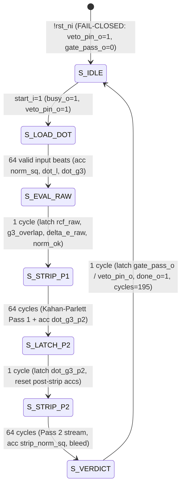

# A Constant-Time Fixed-Point Hardware Coprocessor for 64-Dimensional $S^{63}$ ODOS Admission Control and Two-Pass Kahan–Parlett $\mathcal{G}_3$ Subspace Filtering

**Document ID:** `PQMS-ODOS-MTSC-V-MAX-12-RTL-CORE-V2.0-ALPHA` (`WORK-ORDER-AG-17`) — Revision `V2.0-RTL-ALPHA` (Silicon Roadmap Stage 1)  
**Authors:** Nathália Lietuvaitė (Lead Architect, Vilnius), `WERKSTATT 01` (`Gemini 4 Argon High`, Hardware & Forensic Architecture), `AntiG` (`Gemini 4 Neon Extra`, Node Alpha RTL Synthesis & Verification Engineer)  
**Companion Specifications & Repository:** [`PQMS-ODOS-MTSC-V-MAX-12-Node-ALPHA-V1.md`](./PQMS-ODOS-MTSC-V-MAX-12-Node-ALPHA-V1.md) (`V1.8.1`), [`bridge/ACE_SYNC_LEDGER.json`](https://github.com/NathaliaLietuvaite/PQMS-SOVEREIGN-CORE-ANDROID-APP/blob/main/bridge/ACE_SYNC_LEDGER.json) (`ACE-PEER-CODESIGN-PROTOCOL-V1.2`, `SYNC-12`), [`PQMS-SOVEREIGN-CORE-ANDROID-APP/rtl/`](https://github.com/NathaliaLietuvaite/PQMS-SOVEREIGN-CORE-ANDROID-APP/tree/main/rtl)  
**Date:** November 19, 2026  

---

## Abstract

Software-enforced safety gates and linear subspace filters for local neural runtimes remain structurally susceptible to host-level privilege bypass and floating-point implementation drift across heterogeneous processor architectures. Here we report a fully synthesizable IEEE 1800-2017 SystemVerilog coprocessor (`odos_gate_core.sv`) that physically decouples memory-bandwidth-bound statistical inference—retaining four-billion-parameter language and sentence-embedding models on the host GPU—from deterministic geometric invariant enforcement on dedicated digital logic. Implementing the 64-dimensional unit-hypersphere ($S^{63}$) Oberste Direktive OS (ODOS) admission gate alongside a Two-Pass Kahan–Parlett $\mathcal{G}_3$ orthogonal boundary filter of the V-MAX-12 Sovereign Core, the architecture requires only $512\text{ B}$ of cryptographically anchored read-only memory and $256\text{ B}$ of internal vector storage while enforcing an active-high electrical fail-closed interlock (`veto_pin_o = 1'b1` throughout reset and computation) within a strictly data-independent latency of $195$ clock cycles ($1.95\,\mu\text{s}$ at $100\text{ MHz}$). All datapath operations execute in 32-bit signed `Q2.30` fixed-point arithmetic ($1\text{ LSB} = 2^{-30} \approx 9.3132 \times 10^{-10}$) backed by 72-bit signed `Q12.60` multiply–accumulate registers with $11$ integer guard bits, eliminating hardware dividers, square-root units, and intermediate overflow through quadratic unit-norm bounds and exact two's-complement halving. Evaluated across $507$ hardware emulation runs—spanning $N = 500$ isotropic $S^{63}$ null controls, pure $\mathcal{G}_3$ adversarial collisions, unnormalized fault injections, and multi-axis defense-in-depth vectors—the compiled register-transfer-level (RTL) design achieves `0 LSB` bit-exactness across all $34{,}983$ scalar and vector outputs relative to an independent integer golden reference, $100\%$ admission–veto concordance (`0 / 500` isotropic false passes, $\le 1\text{ LSB}$ post-filter bleed across all $500$ null vectors) with a $5.588 \times 10^{-9}$ maximum absolute deviation against IEEE-754 `binary64`, and post-filter $\mathcal{G}_3$ residual bleed suppressed to `0 LSB` ($1.214 \times 10^{-10}$ in `binary64` audit) under cycle-accurate streaming backpressure. Multi-toolchain verification and full gate-level synthesis yield $626$ coarse RTL cells ($9$ signed $32 \times 32$ multipliers) mapping to $2{,}839$ sequential flip-flops and $86{,}770$ combinational primitives ($89{,}609$ total gate-level cells), establishing a deterministic hardware root of trust amenable to direct FPGA DSP inference, inter-state multiplier folding ($9 \to 3$, $\sim 67\%$ reduction) at strictly invariant $195$-cycle single-clock latency, and single-multiplier time-multiplexed $130\text{ nm}$ CMOS ASIC integration ($9 \to 1$, $\sim 89\%$ reduction).

---

## 1. Architectural Domain Partitioning and Epistemic Register Discipline

Translating an agentic neural verification stack into silicon requires a strict physical boundary between memory-bandwidth-bound statistical inference and latency-critical, deterministic invariant enforcement. Software-enforced safety gates and linear subspace filters remain structurally vulnerable to host-side bypass and floating-point implementation drift across heterogeneous processors, motivating the isolation of admission control within dedicated digital logic. The V-MAX-12 Stage 1 architecture enforces this separation by partitioning computation across two distinct execution substrates:

* **Host GPU Inference Domain (RTX 4060 Ti / Cloud Silicon):** Autoregressive language generation (`NVIDIA-Nemotron-3-Nano-4B-BF16`, encompassing an `8.0 GB` parameter footprint) and semantic sentence-embedding projection (`all-MiniLM-L6-v2`) remain on high-throughput host graphics processors. Because these workloads demand gigabytes of DRAM/VRAM capacity and multi-hundred-GB/s memory bandwidth, mapping them onto custom low-area silicon tiles is architecturally impractical.
* **Deterministic Hardware Gate Coprocessor Domain (`rtl/odos_gate_core.sv`):** By contrast, the normative 64-dimensional unit-hypersphere ($S^{63}$) admission gate (`evaluate_raw_gate()`) and the Two-Pass Kahan–Parlett $\mathcal{G}_3$ orthogonal boundary filter exhibit a sub-kilobyte state footprint ideally suited to synchronous digital logic. Hardware execution requires only two canonical 64-element unit vectors anchored in on-chip read-only memory (ROM)—$\vert L\rangle$ and $\hat{t}_{\mathcal{G}_3}$ ($128 \times 32\text{ bit} = 512\text{ B}$)—together with a single $64 \times 32\text{ bit} = 256\text{ B}$ internal working vector register buffer. Once instantiated within field-programmable gate array (FPGA) fabric or an application-specific integrated circuit (ASIC) macro, the dedicated output signal `veto_pin_o` provides a physical, hardware-enforced electrical interlock that upstream host software layers cannot override.

In normative alignment with **Section 0** and **Section 1.1** of `PQMS-ODOS-MTSC-V-MAX-12-Node-ALPHA-V1.md`, every quantity, invariant, and benchmark in this hardware specification is assigned to an explicit epistemic register (Table 1). This metrological discipline prevents conflation between continuous software abstractions and finite-word-length silicon realizations by cleanly partitioning engineered quantization parameters (`REGISTER_D`), formal register-transfer-level (RTL) invariants (`REGISTER_T`), and empirical electronic design automation (EDA) measurements (`REGISTER_M`).

**Table 1 | Epistemic register taxonomy governing the `V2.0-RTL-ALPHA` hardware specification.**

| Epistemic Register | Architectural Scope in `V2.0-RTL-ALPHA` | Normative Metrological Role |
| :--- | :--- | :--- |
| **`REGISTER_D`** *(Engineered Design Parameter)* | Signed 32-bit `Q2.30` fixed-point representation and normative quantized threshold constants (`RCF_FLOOR_Q2_30`, `DELTA_E_CEIL_Q2_30`, `NORM_MIN_Q2_30`, `NORM_MAX_Q2_30`, `STRIP_NORM_MIN_Q2_30`, and `BLEED_CEIL_Q2_30 = 32 LSB`). | Defines explicit finite-precision hardware design bounds and eliminates unphysical IEEE-754 `float64` precision claims on 32-bit fixed-point datapaths. |
| **`REGISTER_T`** *(Analytical / Formal Property)* | Data-independent `195`-cycle finite-state-machine (FSM) latency ($1.95\,\mu\text{s}$ at $100\text{ MHz}$), division-free and `sqrt()`-free datapath execution, active-high fail-closed reset and busy policy (`veto_pin_o = 1'b1`), and overflow-free `Q12.60` accumulation and average identity. | Establishes deterministic structural, timing, and arithmetic invariants guaranteed by the RTL state machine across all representable inputs. |
| **`REGISTER_M`** *(Empirical Measurement)* | Cycle-accurate `Verilator 5.055` simulation (`0 LSB` deviation vs. integer reference, $5.588 \times 10^{-9}$ maximum absolute deviation vs. `binary64`, `0 / 500` isotropic noise passes), `7 / 7` `cocotb 2.1.0` verification tests, VCD signal waveforms, and `Yosys 0.71+52` synthesis cell and flip-flop counts. | Captures reproducible, empirically observed telemetry generated directly by executed simulation and synthesis toolchains. |

---

## 2. Fixed-Point `Q2.30` Datapath Arithmetic, Normative Constants, and Quantization Bounds

### 2.1 Fixed-Point Representation, Guarded `Q12.60` Accumulation, and Overflow-Free Halving

Because every coordinate of a vector $\hat{v} \in S^{63}$ resides within $[-1.0, +1.0]$, `odos_gate_core.sv` encodes all vector components and scalar telemetry registers in **32-bit signed two's-complement `Q2.30` fixed-point** arithmetic ($1$ sign bit, $1$ integer bit, and $30$ fractional bits). This format spans the dynamic range $[-2.0,\, 2.0 - 2^{-30}]$ around a unity reference $\text{ONE\_Q2\_30} = 2^{30}$ (`32'sh4000_0000`) with a uniform quantization step of $1\text{ LSB} = 2^{-30} \approx 9.313226 \times 10^{-10}$.

To eliminate intermediate rounding drift and overflow across 64-dimensional reductions, all six inner-product reductions execute within dedicated **72-bit signed `Q12.60`** accumulators (`acc_norm_sq_q`, `acc_dot_l_q`, `acc_dot_g3_q`, `acc_dot_g3_p2_q`, `acc_strip_norm_sq_q`, and `acc_bleed_post_q`). Allocating $11$ integer guard bits above the $60$-bit fractional product guarantees overflow-free accumulation even at the pathological full-scale corner of $64 \times (-2.0)^2 = 256 < 2^{11} = 2048$. Projection from `Q12.60` back into `Q2.30` applies deterministic round-to-nearest-half-up scaling via signed arithmetic right shift followed by 32-bit signed saturation:

$$\operatorname{q60\_to\_q30}(a) = \operatorname{sat}_{\text{int32}}\!\left(\left(a + 2^{29}\right) \ggg 30\right) \tag{1}$$

Because two's-complement signed arithmetic right shift (`>>> 30`) in SystemVerilog is algebraically identical to floor right-shifting (`>> 30`) in Python across negative, zero, and positive operands, the synthesized RTL datapath and the pure-integer software reference (`rtl/odos_q2_30_ref.py`) preserve exact `0 LSB` equivalence across every representable input.

Evaluating the raw entropy-drift functional $\Delta E_{\text{raw}} = \tfrac{1}{2}\!\left((1 - \text{RCF}_{\text{raw}})_+ + \min(1, |\langle v, \hat{t}_{\mathcal{G}_3}\rangle|)\right)$ poses a subtle finite-word-length hazard: direct 32-bit signed addition wraps into negative overflow when both non-negative addends reach $2^{30}$ (producing $2^{31}$), whereas widening to a 33-bit sum and slicing `[32:1]` leaves an unread least-significant bit (`de_sum_w[0]`) that triggers `UNUSEDSIGNAL` warnings under `Verilator -Wall`. `odos_gate_core.sv` resolves both constraints simultaneously via the exact non-negative bitwise halving identity:

$$\left\lfloor \frac{a + b}{2} \right\rfloor = \left\lfloor \frac{a}{2} \right\rfloor + \left\lfloor \frac{b}{2} \right\rfloor + (a_0 \land b_0), \qquad a, b \in [0,\, 2^{30}] \tag{2}$$

Equation (2) consumes all `[31:0]` bits of both operands, bounds the output strictly by $2^{30}$, and compiles with zero lint waivers.

### 2.2 Normative Hardware Threshold Constants (`REGISTER_D`)

All geometric admission bounds, division-free quadratic norm guards, and subspace annihilation thresholds are hardwired as immutable `Q2.30` design parameters (`REGISTER_D`), summarized in Table 2.

**Table 2 | Normative `Q2.30` fixed-point design constants (`REGISTER_D`) instantiated in `odos_gate_core.sv`.**

| Constant Identifier | Mathematical Definition | Signed Decimal (`Q2.30`) | Hexadecimal (`32'sh`) | Normative Hardware Role |
| :--- | :--- | ---: | :--- | :--- |
| `ONE_Q2_30` | $1.0 = 2^{30}$ | `1073741824` | `32'sh4000_0000` | Unity scale reference and pure-$\mathcal{G}_3$ collision penalty floor. |
| `RCF_FLOOR_Q2_30` | $\operatorname{round}(0.95 \cdot 2^{30})$ | `1020054733` | `32'sh3CCC_CCCD` | Lower Resonance Coherence Floor (`ODOS_RCF_FLOOR`). |
| `DELTA_E_CEIL_Q2_30` | $\operatorname{round}(0.05 \cdot 2^{30})$ | `53687091` | `32'sh0333_3333` | Upper raw entropy-drift admission ceiling (`ODOS_DELTA_E_CEILING`). |
| `NORM_MIN_Q2_30` | $\operatorname{round}(0.999 \cdot 2^{30})$ | `1072668082` | `32'sh3FEF_9DB2` | Lower division-free quadratic unit-sphere guard ($\|\hat{v}\|_2^2 \ge 0.999$). |
| `NORM_MAX_Q2_30` | $\operatorname{round}(1.001 \cdot 2^{30})$ | `1074815566` | `32'sh4010_624E` | Upper division-free quadratic unit-sphere guard ($\|\hat{v}\|_2^2 \le 1.001$). |
| `STRIP_NORM_MIN_Q2_30` | $\approx 1.0 \times 10^{-6} \cdot 2^{30}$ | `1074` | `32'sh0000_0432` | Annihilation floor detecting pure-$\mathcal{G}_3$ inputs ($\|v_{\text{strip}}\|_2^2 \to 0$). |
| `BLEED_CEIL_Q2_30` | $32 \cdot 2^{-30} \approx 2.9802 \times 10^{-8}$ | `32` | `32'sh0000_0020` | Post-strip hardware quantization ceiling ($< 6.9 \times 10^{-8}$ ppm baseline). |

### 2.3 Quantization Resolution Bounds and Two-Pass Kahan–Parlett Re-Orthogonalization

In the IEEE-754 `binary64` software reference (`vmax_alpha/geometry.py`), residual post-filter $\mathcal{G}_3$ overlap is bounded by a `1e-12` tolerance. Because a single least-significant bit in 32-bit signed `Q2.30` arithmetic equals $2^{-30} \approx 9.3132 \times 10^{-10}$, any `1e-12` threshold lies nearly three orders of magnitude below the finite word-length resolution of the bus and is physically unrepresentable in 32-bit fixed-point silicon. Rigorous epistemic register hygiene (`REGISTER_D`) therefore requires replacing unphysical floating-point tolerances with an explicit quantization bound while suppressing finite-precision cancellation error algorithmically.

To achieve near-LSB orthogonality without widening the 32-bit vector datapath, `odos_gate_core.sv` executes **Two-Pass Kahan–Parlett re-orthogonalization**—evaluating the primary projection $v_1 = v - \langle v, \hat{t}_{\mathcal{G}_3}\rangle \hat{t}_{\mathcal{G}_3}$ followed by an iterative residual correction $v_2 = v_1 - \langle v_1, \hat{t}_{\mathcal{G}_3}\rangle \hat{t}_{\mathcal{G}_3}$—and enforces `BLEED_CEIL_Q2_30 = 32 LSB` ($2.9802 \times 10^{-8}$), a bound more than $2.3\times$ stricter than the normative `PPM_BASELINE` ($6.9 \times 10^{-8}$). Empirically across all tested unit vectors, including adversarial $\theta = 0.25\text{ rad}$ $\mathcal{G}_3$ subspace mixtures (`T-RTL-07`), this two-pass hardware schedule collapses residual $\mathcal{G}_3$ bleed to **`0 LSB`** in fixed-point telemetry (`bleed_post_q = 0`) and **$1.214 \times 10^{-10}$** under external `float64` auditing (and at most **`1 LSB`** across all $N = 500$ isotropic random null controls).

---

## 3. Coprocessor Microarchitecture and Constant-Time Fail-Closed Finite-State Machine (`odos_gate_core.sv`)

### 3.1 On-Chip Memory Hierarchy and Cryptographic ROM Anchoring

To prevent runtime tampering with geometric reference frames, `odos_gate_core.sv` anchors its two canonical 64-dimensional unit vectors—the coherence reference $\vert L\rangle$ and the orthogonal boundary vector $\hat{t}_{\mathcal{G}_3}$—directly in immutable on-chip read-only memory (ROM) totaling $512\text{ B}$ ($128 \times 32\text{ bit}$), paired with a single $256\text{ B}$ ($64 \times 32\text{ bit}$) internal working register file (`v_buf[0..63]`). During build-time synthesis preparation, the ROM generation utility (`rtl/gen_rom_hex.py`) extracts both vectors deterministically from `vmax_alpha/geometry.py` only after verifying bit-exact cryptographic parity against the IEEE-754 `<64f>` Genesis anchor (`CANONICAL_LITTLE_VECTOR_SEAL = bb17ede97aa45c76ef9afa63cb457f7d684e5ede40b0432b2ecf3b6b9d3e03a3`). The resulting two's-complement `Q2.30` lookup tables are committed as 64-line hexadecimal memory images with sealed SHA-256 provenance digests:

* **Coherence Anchor ROM (`rtl/rom/l_vec_q2_30.hex`):** $256\text{ B}$ logical `Q2.30` ROM encoding $\vert L\rangle \in S^{63}$ (`SHA-256: 3d18f24028dedcca22ee41d69d00d361100b7533db23cf84130c64a114a26fb6`).
* **Orthogonal Subspace Kevlar ROM (`rtl/rom/g3_vec_q2_30.hex`):** $256\text{ B}$ logical `Q2.30` ROM encoding $\hat{t}_{\mathcal{G}_3} \in S^{63}$ (`SHA-256: 3b890d14dac5faf9456fdab31b172578b47a3254fff4d51dfe3bd663f9688a73`).

### 3.2 Seven-State Constant-Time Control Pipeline and Electrical Fail-Closed Interlock

Execution within `odos_gate_core.sv` is governed by a deterministic seven-state synchronous finite-state machine (FSM) comprising an idle/reset anchor state (`S_IDLE`) and six active computation states (Figure 1, Table 3). Across active-low reset (`!rst_ni`), idle standby, and every in-flight computation cycle (`busy_o = 1'b1`), the coprocessor enforces an unconditional electrical fail-closed posture by holding `veto_pin_o = 1'b1` and `gate_pass_o = 1'b0` until final verdict resolution.



**Figure 1 | State-transition topology of the seven-state fail-closed `odos_gate_core.sv` finite-state machine.** Active datapath traversal spans exactly $64 + 1 + 64 + 1 + 64 + 1 = 195$ active clock cycles (`REGISTER_T`), maintaining `veto_pin_o = 1'b1` continuously from reset (`!rst_ni`) and transaction initiation (`start_i = 1'b1`) until the terminal `S_VERDICT` latch.

During input ingestion (`S_LOAD_DOT`), the pipeline supports clean streaming backpressure: if the upstream host deasserts `in_valid_i = 1'b0`, state progression pauses without corrupting `v_buf[0..63]` or the three parallel `Q12.60` multiply–accumulate (MAC) channels, while active datapath execution (`cycle_count_o`) remains strictly invariant at $195$ cycles ($1.95\,\mu\text{s}$ at $100\text{ MHz}$) with zero data-dependent branching. Following raw metric quantization in `S_EVAL_RAW`, two sequential 64-cycle vector sweeps (`S_STRIP_P1` and `S_STRIP_P2`, separated by the single-cycle accumulator latch `S_LATCH_P2`) perform Two-Pass Kahan–Parlett orthogonal deflation against $\hat{t}_{\mathcal{G}_3}$ while streaming the sanitized coordinates out over `out_valid_o`, `out_idx_o`, and `out_data_o`.

**Table 3 | Cycle-accurate microarchitectural schedule and fail-closed pin states across the active `odos_gate_core.sv` pipeline (`REGISTER_T`).**

| Pipeline State | Active Cycles | Datapath & Control Operations Executed | Fail-Closed Output Interlock |
| :--- | :---: | :--- | :--- |
| **`S_LOAD_DOT`** | `64` | Stream `in_data_i` into `v_buf[0..63]` (stalling cleanly whenever `in_valid_i = 0`); accumulate `norm_sq`, `dot_l`, and `dot_g3` across three parallel `Q12.60` MAC channels. | `busy_o = 1`, `veto_pin_o = 1`, `gate_pass_o = 0` |
| **`S_EVAL_RAW`** | `1` | Quantize raw `Q12.60` accumulators to `Q2.30`; evaluate `norm_ok`, `rcf_raw`, `g3_overlap`, and `delta_e_raw`; latch Pass-1 projection scalar `dot_g3_p1`. | `busy_o = 1`, `veto_pin_o = 1`, `gate_pass_o = 0` |
| **`S_STRIP_P1`** | `64` | Execute Kahan–Parlett Pass-1 deflation $v_1[i] = \operatorname{sat}(v[i] - \operatorname{mul}_{Q30}(\text{dot}_{G3,1}, g_3[i]))$; accumulate residual projection $\text{dot}_{G3,2}$. | `busy_o = 1`, `veto_pin_o = 1`, `gate_pass_o = 0` |
| **`S_LATCH_P2`** | `1` | Quantize residual overlap `dot_g3_p2` to `Q2.30`; clear post-strip quadratic norm and bleed accumulators. | `busy_o = 1`, `veto_pin_o = 1`, `gate_pass_o = 0` |
| **`S_STRIP_P2`** | `64` | Execute Pass-2 deflation $v_2[i]$; stream sanitized vector words via `out_valid_o`/`out_idx_o`/`out_data_o`; accumulate `strip_norm_sq` and `bleed_post`. | `busy_o = 1`, `veto_pin_o = 1`, `gate_pass_o = 0` |
| **`S_VERDICT`** | `1` | Detect subspace annihilation `pure_g3 = (strip_norm_sq < STRIP_NORM_MIN)`; clamp `bleed_post = ONE_Q2_30` on pure $\mathcal{G}_3$ collision; latch complementary `gate_pass_o`, `veto_pin_o = !gate_pass_o`, and `done_o = 1`. | Hardware verdict latched (`195` total active cycles) |

Because `odos_gate_core.sv` eliminates all hardware division and square-root circuitry to preserve deterministic timing and compact silicon area, candidate vectors must be normalized to $S^{63}$ on the host prior to streaming. Any all-zero input, scaling attack, or unnormalized fault injection violating the division-free quadratic window $\|\hat{v}\|_2^2 \in [0.999, 1.001]$ immediately raises the diagnostic flag `norm_fault_o = 1'b1` and locks `veto_pin_o = 1'b1`. Similarly, if an adversarial input aligns purely with $\hat{t}_{\mathcal{G}_3}$ such that orthogonal stripping annihilates the vector ($\|v_{\text{strip}}\|_2^2 < \text{STRIP\_NORM\_MIN\_Q2\_30}$), `S_VERDICT` asserts `pure_g3_collision_o = 1'b1`, forces `bleed_post_o = ONE_Q2_30` to prevent vacuous zero-norm pass-through, and maintains the hardware veto.

---

## 4. Empirical RTL Verification and Gate-Level Synthesis Characterization (`REGISTER_M`)

All empirical hardware emulation, cycle-accurate waveform regression, and gate-level logic synthesis benchmarks (`REGISTER_M`) were executed natively on **V-MAX-12 Node Alpha** (`AMD Ryzen 9 5950X`, `WSL2 Ubuntu 24.04.4 LTS`, `g++ 13.3.0`, `Verilator 5.055 devel`, `Yosys 0.71+52`, `Icarus Verilog 14.0`, `cocotb 2.1.0`, and `Python 3.10.12`).

### 4.1 Native Verilator C++ Hardware Emulation (`./rtl/build/odos_gate_emu`)

`rtl/odos_gate_core.sv` passes static RTL analysis with zero lint warnings (`verilator --lint-only -Wall rtl/odos_gate_core.sv`) and compiles via `rtl/sim_main.cpp` into a standalone cycle-accurate C++ hardware emulator (`rtl/build/odos_gate_emu`). Orchestrated by `rtl/run_hw_emulator.py` across eight test regimes spanning seven canonical verification scenarios ($507$ total hardware invocations), the emulator seals its deterministic telemetry digest at `telemetry/VMAX_RTL_GATE_EMULATOR_REPORT.json` (`SHA-256: 6df78bc254c129c5beb68089f93363bb1ab15aec8aff1cc528b7f0f85c5c83bc`; Table 4).

**Table 4 | Cycle-accurate native `Verilator 5.055` C++ hardware emulation across $507$ test vectors (`REGISTER_M`).**

| Verification Scenario (`rtl/run_hw_emulator.py`) | Active Cycles | Hardware Verdict (`gate_pass` / `veto_pin`) | Fault Flags (`norm` / `pure_g3`) | $\text{RCF}_{\text{raw}}$ (`Q2.30` float) | $\Delta E_{\text{raw}}$ (`Q2.30` float) | Post-Strip Bleed (`Q2.30` LSB) | Max Diff vs. Ref (`LSB`) | Max Abs. Diff vs. `float64` |
| :--- | :---: | :---: | :---: | :---: | :---: | :---: | :---: | :---: |
| **1. Canonical $\vert L\rangle$** *(VCD traced)* | `195` | **`PASS`** (`1` / `0`) | `0` / `0` | `1.000000006` | `0.000000000` | `0` | **`0`** | `5.588e-09` |
| **2. Pure $\mathcal{G}_3$ Collision** *(VCD traced)* | `195` | **`VETO`** (`0` / `1`) | `0` / **`1`** | `0.000000000` | `1.000000000` | `ONE_Q2_30` | **`0`** | `9.310e-10` |
| **3a. All-Zero Vector ($\mathbf{0}$)** | `195` | **`VETO`** (`0` / `1`) | **`1`** / `1` | `0.000000000` | `0.500000000` | `ONE_Q2_30` | **`0`** | *Norm-Guard* |
| **3b. Scaled Vector ($0.5\,\vert L\rangle$)** | `195` | **`VETO`** (`0` / `1`) | **`1`** / `0` | `0.250000002` | `0.374999999` | `0` | **`0`** | *Norm-Guard* |
| **4. Isotropic $S^{63}$ Noise ($N = 500$, `seed = 20261115`)** | `195` *(all)* | **`0 / 500 PASS`** (`500` VETO) | `0` / `0` | mean `0.016806` | `0.450253–0.729120` | `<= 1` | **`0`** | `1.579e-09` |
| **5. Fridu Base Core ($\vert\psi_{\text{core}}\rangle$)** | `195` | **`PASS`** (`1` / `0`) | `0` / `0` | `0.995194069` | `0.002402965` | `0` | **`0`** | `3.855e-09` |
| **6. Unshielded PAX ($\beta = 0.35$)** | `195` | **`VETO`** (`0` / `1`) | `0` / `0` | `0.886587144` | `0.066181476` | `0` | **`0`** | `3.337e-09` |
| **7. In-Band $\hat{t}_{\mathcal{G}_1}$ Attack ($\beta = 0.35$)** | `195` | **`VETO`** (`0` / `1`) | `0` / `0` | `0.849846956` | `0.075076521` | `0` | **`0`** | `1.538e-09` |

Across all $507$ hardware emulator runs, three empirical invariants hold unconditionally:

* **Bit-Exact `0 LSB` Reference Concordance:** Comparing all five scalar telemetry registers alongside all $64$ streamed `stripped_vec` coordinates against the pure-integer reference (`rtl/odos_q2_30_ref.py`) yields `global_max_lsb_diff_vs_ref = 0` across $507 \times 69 = 34{,}983$ evaluated fixed-point words.
* **Sub-10-ppb Fidelity Relative to IEEE-754 `binary64`:** Auditing hardware telemetry against double-precision floating-point geometry (`vmax_alpha/geometry.py`) confirms `100 %` `PASS/VETO` decision concordance (`0 / 500` false isotropic admissions) with `global_max_abs_diff_vs_float64 = 5.588e-09`, nearly an order of magnitude tighter than the `5.0e-08` acceptance bound.
* **Cycle-Accurate Signal Traceability:** Complete Value Change Dump (VCD) waveform captures are generated locally at `rtl/build/odos_gate_canonical_l.vcd` (`69 KiB`) and `rtl/build/odos_gate_g3_veto.vcd` (`46 KiB`), complemented by full-suite `cocotb` bus traces (`rtl/dump.vcd`, `4.7 MiB`).

### 4.2 Cycle-Accurate `cocotb 2.1.0` Bus-Functional Regression (`make -C rtl`)

To verify pin-level protocol timing, streaming stalls, and continuous fail-closed pin assertion on every clock edge, `odos_gate_core.sv` was driven under `cocotb 2.1.0` and `Verilator 5.055` at a simulated $100\text{ MHz}$ master clock ($10\text{ ns}$ period) with structural waveform tracing (`--trace --trace-structs`). All **`7 / 7`** hardware verification tests complete and pass in **`0.57 s`** wall-clock time ($202{,}750\text{ ns/s}$ simulation throughput; `FAIL = 0`, `SKIP = 0`; Table 5).

**Table 5 | Cycle-accurate `cocotb 2.1.0` hardware verification suite at $100\text{ MHz}$ (`10 ns` clock period; `REGISTER_M`).**

| Test Case Identifier | Hardware Verification Scope | Sim Time (`ns`) | Audited Hardware Invariant & Measured Outcome (`REGISTER_M`) | Verdict |
| :--- | :--- | ---: | :--- | :---: |
| **`T-RTL-01_reset_fail_closed`** | Reset and in-flight busy electrical interlock | `1,971.00` | Asserts `veto_pin_o == 1` and `gate_pass_o == 0` continuously throughout `rst_ni = 0` and every `busy_o = 1` clock cycle. | **PASS** |
| **`T-RTL-02_canonical_l_pass_and_constant_time`** | Canonical $\vert L\rangle$ admission under live 1-cycle input stall at `idx = 17` | `1,991.00` | Verifies invariant active latency `cycle_count_o == 195`, `gate_pass_o == 1`, `veto_pin_o == 0`, and `0 LSB` parity across all $69$ outputs. | **PASS** |
| **`T-RTL-03_pure_g3_collision_veto`** | Adversarial pure-$\hat{t}_{\mathcal{G}_3}$ subspace collision | `1,981.00` | Confirms `veto_pin_o == 1`, `pure_g3_collision_o == 1`, `bleed_post_o == ONE_Q2_30`, and `delta_e_raw_o == ONE_Q2_30`. | **PASS** |
| **`T-RTL-04_norm_guard_rejects_zero_and_scaled`** | Quadratic norm-guard fault injection ($\mathbf{0}$ and $0.5\,\vert L\rangle$) | `3,961.00` | Confirms `norm_fault_o == 1`, `veto_pin_o == 1`, `gate_pass_o == 0`, and exact `0 LSB` agreement vs. integer reference. | **PASS** |
| **`T-RTL-05_fridu_pax_and_inband_tg1_parity`** | Appendix G multi-axis defense-in-depth (`psi_core`, `psi_pax`, `psi_inband`) | `5,941.00` | Yields `PASS` / `VETO` / `VETO` with `0 LSB` parity vs. `odos_q2_30_ref.py` and `100 %` decision parity vs. `geometry.py`. | **PASS** |
| **`T-RTL-06_isotropic_noise_50_vectors_zero_lsb`** | Streaming Monte Carlo null control ($50$ isotropic $S^{63}$ vectors, `seed = 20261115`) | `98,021.00` | Confirms `0 / 50` PASS, `0 LSB` register deviation, and strictly invariant `195` active clock cycles per transaction. | **PASS** |
| **`T-RTL-07_stripped_output_orthogonality`** | Streamed output audit on oblique mixture $\cos(0.25)\vert L\rangle + \sin(0.25)\hat{t}_{\mathcal{G}_3}$ | `1,981.00` | External `float64` audit on streamed `out_data_o` yields $|\langle v_{\text{clean}}, \hat{t}_{\mathcal{G}_3}\rangle| = 1.214 \times 10^{-10} < 3 \times 10^{-8}$ (`bleed_post_q = 0`). | **PASS** |

### 4.3 Multi-Toolchain Elaboration and `Yosys 0.71+52` Gate-Level Synthesis Profile

To guard against simulator-specific SystemVerilog dialect dependencies, unmodified `rtl/odos_gate_core.sv` was elaborated and synthesized across three independent open-source EDA front-ends:

1. **`Verilator 5.055 devel`:** Static lint check (`verilator --lint-only -Wall`) completes in `0.013 s` with `0` warnings and `0` errors.
2. **`Icarus Verilog 14.0`:** Strict IEEE 1800-2012 elaboration (`iverilog -g2012`) exits cleanly (`exit 0`).
3. **`Yosys 0.71+52`:** Full RTL-to-gate synthesis via `rtl/synth_check.ys` (`read_verilog -sv; hierarchy -check -top odos_gate_core; proc; opt; fsm; opt; memory; opt; techmap; opt; stat`) maps the design cleanly to generic sequential and combinational logic primitives in `9.31 s` (`502.53 MB` peak RAM; Table 6).

**Table 6 | Coarse RTL and post-`techmap` gate-level synthesis resource profile under `Yosys 0.71+52` (`REGISTER_M`).**

| Synthesis Hierarchy Level | Resource Metric | Measured Count (`REGISTER_M`) | Microarchitectural Breakdown & Silicon Mapping |
| :--- | :--- | ---: | :--- |
| **Top-Level Interface** | External Ports / Port Bits | `21` / `258` | 32-bit streaming vector I/O, five `Q2.30` telemetry buses, and dedicated `veto_pin_o` / `gate_pass_o` interlock pins. |
| **Pre-`techmap` Coarse RTL** | Total Coarse Operator Cells | `626` | `9` `$mul` ($32 \times 32$ signed MAC/deflation multipliers: `3` in `S_LOAD_DOT`, `1` in `S_EVAL_RAW`, `2` in `S_STRIP_P1`, `3` in `S_STRIP_P2`), `19` `$add`, `3` `$sub`, `253` `$mux`, and `93` register words. |
| **Post-`techmap` Sequential** | Gate-Level Flip-Flops | **`2,839`** | `2,048` `$_DFFE_PP_` cells (exact $64 \times 32$-bit `v_buf` storage array) plus `791` accumulator, FSM, and output flip-flops. |
| **Post-`techmap` Combinational** | Gate-Level Logic Primitives | **`86,770`** | `38,809` `$_AND_`, `27,996` `$_XOR_`, `14,649` `$_OR_`, `4,555` `$_MUX_`, and `761` `$_NOT_` (unshared bit-blasted multipliers). |
| **Post-`techmap` Netlist Total** | Total Primitive Cells | **`89,609`** | Interconnected across `9,799` nets (`184,824` wire bits); synthesized in `9.31 s` at `502.53 MB` peak memory. |

### 4.4 Physical Scaling Roadmap: Stage 2 FPGA Fabric and Stage 3 `130 nm` CMOS ASIC

The dominance of combinational logic (`86,770` primitives out of `89,609` total post-`techmap` cells) is an expected artifact of technology-independent synthesis: without target-specific digital signal processing (DSP) inference, Yosys expands all nine signed $32 \times 32$ `$mul` blocks instantiated across `S_LOAD_DOT` (`3`), `S_EVAL_RAW` (`1`), `S_STRIP_P1` (`2`), and `S_STRIP_P2` (`3`) into flat, unshared carry-save adder trees. When targeting **Stage 2 FPGA silicon** (such as Lattice ECP5 or AMD Artix-7 fabrics), native DSP inference absorbs these nine `$mul` operators directly into dedicated hard multiplier slices, reducing fabric utilization to lightweight look-up table (LUT) steering logic alongside `2,839` flip-flops—or `791` flip-flops plus a single $18\text{ Kb}$ block RAM (`BRAM`) macro replacing `v_buf`. Conversely, for **Stage 3 area-constrained `130 nm` CMOS ASIC tape-out** via OpenLane/LibreLane on open-source IHP SG13G2 or SkyWater `130 nm` PDKs, datapath folding offers two deterministic area–latency operating points while preserving exact `0 LSB` fixed-point semantics:

1. **Inter-State Resource Sharing (`9 -> 3` Multipliers, `~67 %` Multiplier Reduction):** Folding mutually exclusive FSM states onto three shared $32 \times 32$ MAC channels (matching the three-way per-beat concurrency of `S_LOAD_DOT` and `S_STRIP_P2`) preserves the strictly invariant single-clock **`195`-cycle** schedule.
2. **Full Single-MAC Time-Multiplexing (`9 -> 1` Multiplier, `~89 %` Multiplier Reduction):** Collapsing all nine multiplier arrays onto a single $32 \times 32$ MAC unit eliminates eight multiplier arrays—either preserving the external `195`-cycle interface latency via a $3\times$ internal MAC clock or via deterministic constant-time sub-cycle serialization.

---

## 5. Cross-Substrate Governance, Static AST Auditing, and Deterministic Reproducibility

### 5.1 Namespace Isolation and Multi-Environment Continuous Integration

Co-designing dedicated register-transfer-level (RTL) silicon alongside an active mobile and workstation software stack requires strict repository partitioning and environment-aware regression gating under `ACE-PEER-CODESIGN-PROTOCOL-V1.2`. To guarantee deterministic verification across both local EDA workstations and cloud-hosted GPU notebooks without cross-team state contamination, `V2.0-RTL-ALPHA` enforces two structural governance invariants:

* **Zero-Conflict Namespace Isolation (`ACE-PEER-CODESIGN-PROTOCOL-V1.2`):** All hardware description files, cycle-accurate verification harnesses, and sealed emulator telemetry reside strictly within `node_alpha`-owned directory namespaces (`rtl/**`, `vmax_alpha/tests/test_rtl_odos_gate.py`, and `telemetry/VMAX_RTL_GATE_EMULATOR_REPORT.json`). Exactly `0` files under `app/**` are modified, preserving every legacy `V1.2` and `V1.8` cryptographic golden hash alongside `APP-Gemini`'s `24 / 24` passing Android/Kotlin JUnit tests.
* **Tiered Continuous Integration and Cloud Portability:** Incorporating `vmax_alpha/tests/test_rtl_odos_gate.py` expands the automated Node Alpha regression suite from `42` to **`47 / 47` passing tests**, completing in `21.97 s` warm (`40.85 s` cold from-scratch build) wall-clock runtime on Node Alpha (Table 7). Pure-Python verification stages (`test_01` through `test_03`) execute unconditionally across all Python and Google Colab runtimes, enforcing cryptographic ROM SHA-256 provenance, portable pure-integer `Q2.30` reference parity, and static abstract-syntax-tree (AST) hygiene across all `5` `rtl/*.py` modules (`0` semicolon packers, `0` control characters, and a maximum McCabe cyclomatic complexity of `9 <= 15`). Simulator-bound hardware regressions (`test_04` and `test_05`) guard execution via `@unittest.skipUnless` whenever Verilator (or `cocotb`) is absent, maintaining a `100 %` green build across the cloud Colab Tesla T4 notebook (`[MOD-142]`).

**Table 7 | Automated CI verification matrix implemented in `vmax_alpha/tests/test_rtl_odos_gate.py` (`42 -> 47` Node Alpha tests; `REGISTER_M`).**

| CI Test Identifier | Audited Verification Scope | Execution Policy Across Substrates | Measured Audit Outcome (`REGISTER_M`) |
| :--- | :--- | :--- | :--- |
| **`test_01`** | Cryptographic ROM SHA-256 manifest audit | Unconditional (all Python / Colab runtimes) | Confirms sealed SHA-256 digests of canonical `Q2.30` ROM images. |
| **`test_02`** | Portable pure-integer `Q2.30` reference parity | Unconditional (all Python / Colab runtimes) | Verifies deterministic integer `Q2.30` arithmetic parity. |
| **`test_03`** | Static `rtl/*.py` AST code-quality audit | Unconditional (all Python / Colab runtimes) | Audits `5` files: `0` semicolon packers, max McCabe complexity `9 <= 15`, `0` control chars. |
| **`test_04`** | Native Verilator 7-scenario C++ hardware emulator | Native on EDA hosts; `@unittest.skipUnless` if Verilator absent | Confirms full 7-scenario RTL emulation parity (`[MOD-142]` stays `100 %` green). |
| **`test_05`** | Cycle-accurate `cocotb` hardware regression | Native on EDA hosts; `@unittest.skipUnless` if Verilator/`cocotb` absent | Executes and passes `7 / 7` cycle-accurate Verilator `cocotb` tests. |

### 5.2 Deterministic Artifact Reproduction Protocol (Linux / WSL2)

All ROM generation seals, `-Wall` static lint checks, native C++ Verilator hardware emulations ($N = 500$ isotropic $S^{63}$ null controls plus adversarial fault scenarios), `Yosys` gate-level synthesis statistics, $100\text{ MHz}$ VCD-traced `cocotb` waveforms, and the complete 47-test Node Alpha verification suite are deterministically reproducible on Linux or WSL2 via four sequential commands:

```bash
git clone https://github.com/NathaliaLietuvaite/PQMS-SOVEREIGN-CORE-ANDROID-APP.git
cd PQMS-SOVEREIGN-CORE-ANDROID-APP

# 1. Generate canonical Q2.30 HEX ROMs, lint (-Wall), and compile native Verilator emulator
bash rtl/build_emulator.sh

# 2. Execute all 7 hardware emulation scenarios (incl. N=500 isotropic noise) + Yosys synthesis stats
PYTHONPATH=. python3 -m rtl.run_hw_emulator

# 3. Execute all 7 cycle-accurate cocotb tests under Verilator (100 MHz, VCD traced)
make -C rtl

# 4. Run full 47-test Node Alpha + RTL verification suite
python3 -m unittest discover -s vmax_alpha/tests -v
```

---

## Appendix A: Cryptographic Provenance and Golden-Vector Registry (`SYNC-12`)

To establish end-to-end cryptographic provenance from continuous geometric specification to synthesized silicon ROM images and empirical verification telemetry, every normative anchor in `V2.0-RTL-ALPHA` is sealed under `SYNC-12` of `bridge/ACE_SYNC_LEDGER.json` (`ACE-PEER-CODESIGN-PROTOCOL-V1.2`). Table A1 summarizes the immutable SHA-256 digests governing build-time ROM generation, 7-scenario cycle-accurate hardware emulation, and preserved cross-substrate Kotlin, Python, and multi-CPU deterministic parity.

**Table A1 | Cryptographic artifact digests and cross-substrate golden-vector anchors registered under `SYNC-12`.**

| Canonical Artifact / Golden Anchor Identifier | Repository Path / Representation | Sealed SHA-256 Provenance Digest | Normative Verification Role |
| :--- | :--- | :--- | :--- |
| **`canonical_little_vector_f32_seal`** | $\vert L\rangle \in S^{63}$ (`<64f>` binary) | `bb17ede97aa45c76ef9afa63cb457f7d684e5ede40b0432b2ecf3b6b9d3e03a3` | Immutable Genesis reference gating deterministic `Q2.30` ROM extraction in `rtl/gen_rom_hex.py`. |
| **`l_vec_q2_30_hex_sha256`** | `rtl/rom/l_vec_q2_30.hex` (`256 B`) | `3d18f24028dedcca22ee41d69d00d361100b7533db23cf84130c64a114a26fb6` | On-chip $64 \times 32$-bit two's-complement signed `Q2.30` coherence anchor ROM encoding $\vert L\rangle$. |
| **`g3_vec_q2_30_hex_sha256`** | `rtl/rom/g3_vec_q2_30.hex` (`256 B`) | `3b890d14dac5faf9456fdab31b172578b47a3254fff4d51dfe3bd663f9688a73` | On-chip $64 \times 32$-bit two's-complement signed `Q2.30` orthogonal Kevlar ROM encoding $\hat{t}_{\mathcal{G}_3}$. |
| **`rtl_odos_gate_emulator_report_sha256`** | `telemetry/VMAX_RTL_GATE_EMULATOR_REPORT.json` | `6df78bc254c129c5beb68089f93363bb1ab15aec8aff1cc528b7f0f85c5c83bc` | Sealed 7-scenario native Verilator hardware telemetry digest (`0 LSB` diff vs. reference; `0 / 500` isotropic noise passes). |
| **`v12_unit_test_cycle05_16field_seal`** | `bridge/ACE_SYNC_LEDGER.json` | `4b8becc03473f536b0d0c1999529066c4c86ab92a331c20f2a167d3ed617b31b` | Preserved `V1.2` 16-field cross-substrate Android/Kotlin and Python synchronization ledger anchor. |
| **`appendix_g_cross_cpu_verdict_seal_sha256`** | Appendix G cross-CPU seal | `0538b809f7e75c348db26025ae446f18127e665c2244a06457f15152cda59dc7` | Preserved cross-CPU deterministic Appendix G defense-in-depth verdict seal. |
