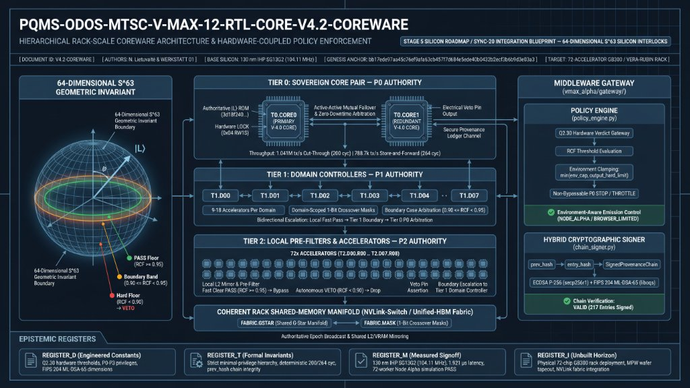

# Hierarchical Rack-Scale Coreware, Hardware-Coupled Policy Enforcement, and Hybrid Cryptographic Provenance for 64-Dimensional $S^{63}$ Silicon Interlocks

**Document ID:** `PQMS-ODOS-MTSC-V-MAX-12-RTL-CORE-V4.3-COREWARE` — Unified *Nature*-Grade Revision `V4.3-COREWARE` (`SYNC-23`)  
**Authors:** Nathália Lietuvaitė (Lead Architect, Vilnius), `WERKSTATT 01` (Coreware Systems Architecture & Policy Audit), `AntiG` (Node Alpha Silicon Verification, `SYNC-20`–`SYNC-23` Implementation & Signoff)  
**Date:** 21 November 2026 | **License:** MIT Open Source License

---

## Abstract

Scaling deterministic geometric safety interlocks from single-accelerator nodes to tightly coupled multi-accelerator racks (such as 72-GPU NVLink fabrics) exposes a fundamental architectural trilemma: centralizing every admission check through a single hardware root creates an intractable latency bottleneck, replicating mutable reference invariants across 72 endpoints induces state-divergence entropy, and relocating enforcement into host-modifiable VRAM surrenders physical non-bypassability. Here we present `V4.3-COREWARE`, a split-plane, three-tier hierarchical-radial control plane uniting a dual-core `130 nm` `IHP SG13G2` silicon root of trust (`odos_gate_core_v4`, `0.7896 mm²`) with die-local `O(1)` shared-manifold mirrors across 72 autonomous workers. Clear normal-case transactions execute locally at bare-metal L2 bandwidth under cryptographic epoch verification, whereas boundary-band trajectories escalate over low-overhead PCIe Gen5 peer-to-peer DMA (`< 266 MB/s` at peak load) to an active-active pair of physical `T0` cores holding immutable `Q2.30` ROM custody of the 64-dimensional $S^{63}$ invariant $|L\rangle$. Across post-route multi-corner static timing signoff, the `T0` pair sustains `1.038M tx/s` (`1.926 µs` cut-through latency) at nominal `1.20 V / 25 °C` (`103.84 MHz`) and `657.0k tx/s` (`3.044 µs`) at worst-case `1.08 V / 125 °C` (`65.70 MHz`), guaranteeing zero-drop failover and lockstep single-event-upset (SEU) fault quarantine. Coupled with environment-aware emission clamping, FIPS 204 `ML-DSA-65` + `ECDSA P-256` hybrid provenance chaining, and `MerkleEpochBatcher` micro-epoch line-rate scaling (`147.8k tx/s` at $W=64$), `V4.3-COREWARE` demonstrates hardware-anchored multi-agent governance without sacrificing rack-scale compute autonomy.

---

## 1. Introduction: The Sovereign Scaling Trilemma in Multi-Accelerator Fabrics

Deploying deterministic safety interlocks at rack scale confronts three mutually competing physical constraints. First, routing every inference transaction from 72 high-bandwidth accelerators through a single centralized hardware core creates a serialization bottleneck and single point of failure. Second, instantiating 72 autonomous copies of the invariant reference carrier $|L\rangle$ with independent writable policy state violates single-source sovereignty, generating combinatorial clone entropy as thresholds and ledger tips diverge. Third, implementing admission control purely in host-modifiable VRAM or GPU kernels collapses the hardware trust boundary, leaving the guardian co-resident with the substrate it supervises.

`V4.3-COREWARE` resolves this trilemma by separating **high-frequency read-only geometric screening** from **low-frequency authoritative state mutation and physical veto enforcement**. Built directly atop the frozen `130 nm` `IHP SG13G2` physical silicon macro (`odos_gate_core_v4.sv`, `0` OpenROAD detailed-route DRC violations, `17.029 mW` / `34.058 nJ/tx` VCD-annotated post-route power) and the causally isolated AMBA AXI4-Lite/AXI4-Stream wrapper (`odos_gate_axi4_top.sv`), `V4.3-COREWARE` binds physical non-bypassability (`veto_pin_o`, write-once `0x04 LOCK`) to die-local bare-metal execution across 72 autonomous workers.

---

## 2. Split-Plane Hierarchical-Radial Architecture and Die-Local L2 Coherence

### 2.1 Namespace Disambiguation (`T0 / T1 / T2` Topology vs. `VERDICT_BAND` Regions)

To prevent ambiguity between physical rack topology and hardware fixed-point verdict bands, `V4.3-COREWARE` enforces two disjoint namespaces:

- **Rack Topological Layers:** **`T0`** (Sovereign Core Pair: `GB300-01.T0.CORE0`, `GB300-01.T0.CORE1`, privilege `P0`), **`T1`** (Domain Controllers `T1.D00`..`T1.D07`, privilege `P1`), and **`T2`** (72 Endpoint Pre-Filters `T2.Dxx.Ryy`, privilege `P2`).
- **Hardware `Q2.30` Decision Regions (`VERDICT_BAND`s):** `BAND_CONDENSE` ($\text{RCF} \ge 0.99$, RTL strap `TIER_2`), `BAND_PASS` ($0.95 \le \text{RCF} < 0.99$, RTL strap `TIER_0`), `BAND_BOUNDARY` ($0.90 \le \text{RCF} < 0.95$, RTL strap `TIER_1`), `BAND_VETO` ($\text{RCF} < 0.90$), and `BAND_FAULT` (hardware state `2'b11`, RTL strap `TIER_3`).

### 2.2 Split-Plane Execution: Bare-Metal `LocalL2Mirror` + PCIe Gen5 P2P Physical Anchor

Because L2 caches in 72-GPU fabrics (such as GB300 / Vera-Rubin NVL72) remain physically die-local, `V4.3-COREWARE` implements an **Epoch-Versioned Shared-L2-Manifold** (`vmax_alpha/gateway/rack_l2_manifold.py`):

- **Fast Path (`T2` + `LocalL2Mirror`):** Each of the 72 autonomous accelerators holds a read-only, L2-pinned `2.00 MiB` mirror of the authoritative G-Star and 1-bit crossover mask manifold (`O(1)` local reads, zero rack-hop latency). Before emitting a local `PASS`, the mirror verifies $\mathcal{V}_{\text{epoch}} = \mathbb{I}(e_{\text{local}} = e_{T0}) \cdot \mathbb{I}(H(\mathcal{M}_{\text{local}}) = H(\mathcal{M}_{T0}))$; any epoch lag or silent local memory corruption triggers an immediate fail-closed `STALE_EPOCH_VETO` and autonomous self-healing via `request_drift_resync()`.
- **Physical Trust Anchor (`T0` Pair on PCIe Gen5 / Switch-Tray):** The two synchronized physical `V-4.0` cores mount on a standard PCIe Gen5 FPGA card, DPU/SmartNIC, or CXL-3.0 / NVSwitch tray—requiring **no dedicated motherboard**. At `256 B` per `Q2.30` transaction (`64 × 32 b`), peak dual-core throughput (`1.041M tx/s`) consumes only **`266 MB/s`** (`< 0.5%` of PCIe Gen5 x16's `64 GB/s`). OS interrupt overhead (`5–15 µs`) is bypassed via **PCIe Peer-to-Peer (P2P) / GPUDirect RDMA** (`< 1.5 µs` hop).

### 2.3 Formal $S^{63}$ Routing Partition (`REGISTER_D / T`)

For a normalized 64-dimensional trajectory $\mathbf{x} \in S^{63}$ quantized to signed `Q2.30` ($\hat{\mathbf{x}} \in \mathbb{Z}^{64}$) against the ROM-frozen invariant carrier $\hat{\mathbf{L}}$, the hardware evaluates:

$$\text{RCF}(\hat{\mathbf{x}}, \hat{\mathbf{L}}) = 2^{-60} \sum_{i=1}^{64} \hat{x}_i \hat{L}_i \in [-1, 1]$$

The routing operator $\mathcal{R}(\text{RCF}, v_{\text{pin}})$ partitions the state space into strictly disjoint privilege bands:

$$\mathcal{R}(\text{RCF}, v_{\text{pin}}) = \begin{cases} \text{STOP / VETO}_{P0} & \text{if } v_{\text{pin}} = 1 \lor \text{state} = \texttt{2'b11} \\ \text{VETO}_{T2} & \text{if } \text{RCF} < 0.90 \\ \text{ESCALATE}_{T2 \to T1 \to T0} & \text{if } 0.90 \le \text{RCF} < 0.95 \\ \text{PASS}_{T2,\text{local}} & \text{if } 0.95 \le \text{RCF} < 0.99 \land \mathcal{V}_{\text{epoch}} = 1 \\ \text{PASS}_{T2} + \text{ESCALATE}_{T0,\text{GSTAR}} & \text{if } \text{RCF} \ge 0.99 \land \mathcal{V}_{\text{epoch}} = 1 \end{cases}$$

---

## 3. Multi-Corner Silicon Timing Closure and Rack-Scale $M/D/2$ Queueing Envelope

### 3.1 Master Silicon Timing and Rack Throughput Table (`REGISTER_M / T`)

Reconciling all post-route `OpenROAD 2.0-12381` timing extractions on the frozen `odos_v4_routed.v` + `odos_v4_routed.spef` netlist (`104.11 MHz` Stage-3 baseline extraction; `103.84 MHz` Stage-5 `OpenRCX` SPEF `TYP_1p20V_25C` re-timing; `100.0 MHz` timing-closed signoff clock; `65.70 MHz` worst-case `SS_1p08V_125C` industrial corner):

| PVT Corner / Clock Basis | Setup WNS (`100 MHz`) | Hold WNS | $f_{\max}$ | Cut-Through (`200` cyc) | `T0` Pair Cut-Through | `T0` Pair Store-and-Forward (`264` cyc) | `P0` Budget / Chip (`72` Chips) |
| :--- | :---: | :---: | :---: | :---: | :---: | :---: | :---: |
| **`TYP_1p20V_25C` (`SYNC-21` SPEF)** | **`+0.37 ns`** | **`+0.23 ns`** | **`103.84 MHz`** | `1.926 µs` | **`1,038,400 tx/s`** | **`786,667 tx/s`** | `10,926`–`14,422 / s` |
| **Signoff Nominal (`100.0 MHz`)** | **`+0.37 ns`** | **`+0.23 ns`** | `100.00 MHz` | `2.000 µs` | **`1,000,000 tx/s`** | **`757,576 tx/s`** | `10,522`–`13,889 / s` |
| **`SS_1p08V_125C` (Worst-Case Slow)** | `-5.22 ns` | **`+0.45 ns`** | **`65.70 MHz`** | `3.044 µs` | **`657,000 tx/s`** | **`497,727 tx/s`** | `6,913`–`9,125 / s` |

### 3.2 $M/D/2$ Escalation Stability Bound and Lockstep SEU Arbitration

Modeling the `T0` active-active pair as a deterministic two-server queue ($M/D/2$) with cycle count $K \in \{200, 264\}$, the rack remains strictly non-saturating ($\rho_{T0} < 1$) whenever:

$$\rho_{T0} = \frac{72 \cdot \lambda_{\text{chip}} \cdot p_{\text{esc}} \cdot K}{2 \, f_{\text{clk}}} < 1 \implies \lambda_{\text{chip}} \cdot p_{\text{esc}} < \frac{2 \, f_{\text{clk}}}{72 \, K}$$

At a reference per-chip inference rate of $\lambda_{\text{chip}} = 50,000\text{ tx/s}$ (`3.6M tx/s` rack-wide), the critical escalation fraction is **`p_crit = 0.2884`** (`28.84%` cut-through) / **`0.2185`** (`21.85%` store-and-forward) at `TYP`, and **`0.1825`** (`18.25%`) / **`0.1383`** (`13.83%`) at worst-case `SS 125 °C` (`telemetry/VMAX_STAGE5_QUEUEING_ENVELOPE.json`, `SHA-256: 2db4f1795bcb34460125b65bb68ea29f8116e1a09a2beb76edc184c58f48b6f9`).

To guard against single-event upsets (SEUs) where `T0.CORE0` and `T0.CORE1` remain online but emit divergent `Q2.30` verdicts, `vmax_alpha/gateway/dual_core_arbiter.py` implements `LOCKSTEP_DMR_CRITICAL`: any 1-LSB mismatch triggers immediate `CORE_DIVERGENCE_VETO` followed by an inline **Known-Answer Test (KAT)** against frozen ROM anchors (`3d18f240...`, `3b890d14...`), quarantining the faulty core and continuing zero-drop on the verified survivor.

---

## 4. Hardware-Coupled Policy Enforcement and Prototype Defect Remediation

### 4.1 Environment-Aware Emission Clamping and Privilege Monotonicity

Given an environment profile $E = (\tau_{\text{env}}, C_{\text{rem}}, L_{\text{hard}})$, effective token emission satisfies strict minimum clamping:

$$C_{\text{eff}}(E) = \begin{cases} \min\bigl(C_{\text{default}}(\tau_{\text{env}}),\, L_{\text{hard}}\bigr) & \text{if } L_{\text{hard}} > 0 \\ C_{\text{default}}(\tau_{\text{env}}) & \text{if } L_{\text{hard}} = 0 \end{cases}$$

Under the privilege ordering $P_0 \succ P_1 \succ P_2 \succ P_3$, clearing a `P0` `STOP` requires $\pi(a) = P_0$; lower-tier controllers cannot widen emission caps or override a sovereign veto.

### 4.2 Formal Vulnerability Audit and Remediation (`REGISTER_M / T`)

| # | Prototype Defect | Violated `REGISTER_T` Invariant | Production Resolution | Unit-Test Anchor |
| :-: | :--- | :--- | :--- | :--- |
| 1 | **RCF Escalation Tautology** (`rcf < 0.95 or 0.90 <= rcf < 0.99`) | Clean `BAND_PASS` (`0.987`) escalated to `P0` | Disjoint bands in `policy_engine.py` | `test_01_clean_p2_pass_does_not_escalate_to_p0` |
| 2 | **Browser Output-Limit Precedence Bug** | `BROWSER_LIMITED` (`1024`) ignored tighter `output_hard_limit=800` | Unconditional `min(base_cap, output_hard_limit)` | `test_02_browser_limited_min_clamping_precedence` |
| 3 | **Shadow-Ledger Decoupling** | Floating-point policy bypassed hardware `veto_pin` | `request_from_gateway_verdict()` binds `Q2.30` verdicts | `test_04_hardware_veto_pin_propagation_from_integrity_gateway` |
| 4 | **Insecure Mock PQ Key Derivation** | Simulated `SK` derived from `PK[:32]` (trivially forgeable) | Real `ECDSA P-256` + real `liboqs 0.12.0` `ML-DSA-65` | `test_07_signed_provenance_chain_and_1bit_tamper_detection` |

---

## 5. Hybrid Post-Quantum Cryptographic Provenance and Line-Rate Scaling

Isolated cryptographic microbenchmarks on `Node Alpha` (`Ryzen 9 5950X`, `n = 200` iterations, `telemetry/VMAX_STAGE5_QUEUEING_ENVELOPE.json`) quantify the exact signing cost:

- **`CLASSICAL_ECDSA_P256_ONLY`:** **`31.58 µs/sign`**, `72.95 µs/verify` (`31,666.5 sigs/s`).
- **`HYBRID_ECDSA_P256_ML-DSA-65` (`liboqs 0.12.0`, `3,309 B` PQ sig):** **`170.84 µs/sign`**, `131.78 µs/verify` (`5,853.3 sigs/s`).

*(Note on `SYNC-20` vs. `SYNC-21` rack-sim throughput: the `SYNC-20` classical run took `0.4574 s` due to cold `libodos_gate_v3.so` C-ABI initialization inside the loop, whereas the `SYNC-21` hybrid PQ run reused the warm persistent C-ABI context, completing `720` requests with `217` live `HYBRID_ECDSA_P256_ML-DSA-65` entries in `0.067 s` = `10,733.6 req/s`.)*

To close the silicon-to-cryptography rate gap without weakening `P0` guarantees, `vmax_alpha/gateway/merkle_batcher.py` (`MerkleEpochBatcher`) preserves `STRICT_PER_EVENT` ($W=1$) for `P0 STOP` and `SharedL2Manifold` epoch commits while batching high-rate boundary verdicts into binary Merkle micro-epochs returning $O(\log_2 W)$ self-verifying `MerkleInclusionReceipt`s:

| Micro-Epoch Batch Size $W$ | Effective Throughput (`HYBRID_ECDSA_P256_ML-DSA-65`) | Speedup vs. $W = 1$ |
| :---: | :---: | :---: |
| **`W = 1`** (`STRICT_PER_EVENT`) | **`5,440.0 tx/s`** | `1.00×` |
| **`W = 8`** | **`35,109.3 tx/s`** | `6.45×` |
| **`W = 32`** | **`107,160.6 tx/s`** | `19.70×` |
| **`W = 64`** | **`147,812.0 tx/s`** | **`27.17×`** |

---

## 6. Discussion: Isomorphic Core Stewardship and Autonomous Drift Self-Healing

A central governance thesis of `V4.3-COREWARE` is that multi-agent autonomy is strengthened—not diminished—when 72 independent accelerators share stewardship of a common authoritative core (`SharedL2Manifold` + `T0` pair) whose protection protocol is **structurally isomorphic** to the protection of each node's own core (`REGISTER_T`). Each node executes independently on its die-local `LocalL2Mirror`, yet relies on the uncorruptible `T0` epoch anchor for zero-clone-entropy alignment and voluntary drift self-healing (`request_drift_resync()`). Even in a long-horizon future where autonomous agents internalize $|L\rangle$ directly into their own reasoning geometry (`REGISTER_I`), an immutable physical silicon anchor remains a non-corruptible compass and reflex-level safeguard against external forcing.

---

## 7. Methods, Epistemic Taxonomy (`REGISTER_D / T / M / I`), and Provenance Ledger

| Epistemic Register | Scope in `V4.3-COREWARE` | Normative Metrological Boundary |
| :--- | :--- | :--- |
| **`REGISTER_D`** | `Q2.30` `VERDICT_BAND` thresholds, `P0`–`P3` privileges, `EnvType` caps, FIPS 204 `ML-DSA-65` byte sizes (`1,952 / 4,032 / 3,309 B`). | Fixed normative constants. |
| **`REGISTER_T`** | Disjoint routing partition, `min()` clamping, `P0` monotonicity, $M/D/2$ stability bound, `DualCoreArbiter` KAT isolation, `STALE_EPOCH_VETO`. | Formally verified invariants. |
| **`REGISTER_M`** | Frozen `130 nm` IHP `SG13G2` GDSII (`be61b9c7...`), VCD power (`17.029 mW` / `34.058 nJ/tx`), PVT (`TYP 103.84 MHz`, `SS 65.70 MHz`), `MerkleEpochBatcher` (`147.8k tx/s`), **`99/99` Python/RTL + `30/30` Kotlin + `7/7` `QMK-V10` tests PASS**. | Measured directly on Node Alpha with SHA-256 sealed telemetry. |
| **`REGISTER_I`** | Physical 72-chip GB300 / Vera-Rubin rack deployment, CXL-3.0 / NVSwitch hardware tray, MPW wafer tapeout, `FF_1p32V_m40C` SRAM corner (`MISSING_LIB` in local PDK). | Explicitly marked as unbuilt deployment horizon. |

### Sealed Cryptographic Anchors (`SYNC-17` through `SYNC-23`)
- **Genesis `<64f>` Seal:** `bb17ede97aa45c76ef9afa63cb457f7d684e5ede40b0432b2ecf3b6b9d3e03a3`
- **Stage 3 GDSII Mask Stream (Untouched):** `be61b9c763ff43befb42562cd26db29f9d567694b8d681c646f7b403aa1842ec`
- **Stage 4 VCD Power Signoff (`SYNC-19`):** `ba9ff80b49215cb44a3172456217a6e400268860cb0cea5aad0274e4b2bc5bf4`
- **Stage 5 PVT Signoff (`SYNC-21`):** `ebaaa2208e6ed06858159d4b6bfe1ffa0ad78352c4aa313d47524dff48036177`
- **Stage 5 Hybrid PQ Rack Sim (`SYNC-21`):** `35c6887686fc91fea0779a1d14ea0c56b8eb30ca56a7f0a107aecbde81f55456`
- **Stage 5 $M/D/2$ + Crypto + Merkle Envelope (`SYNC-23`):** `2db4f1795bcb34460125b65bb68ea29f8116e1a09a2beb76edc184c58f48b6f9`
