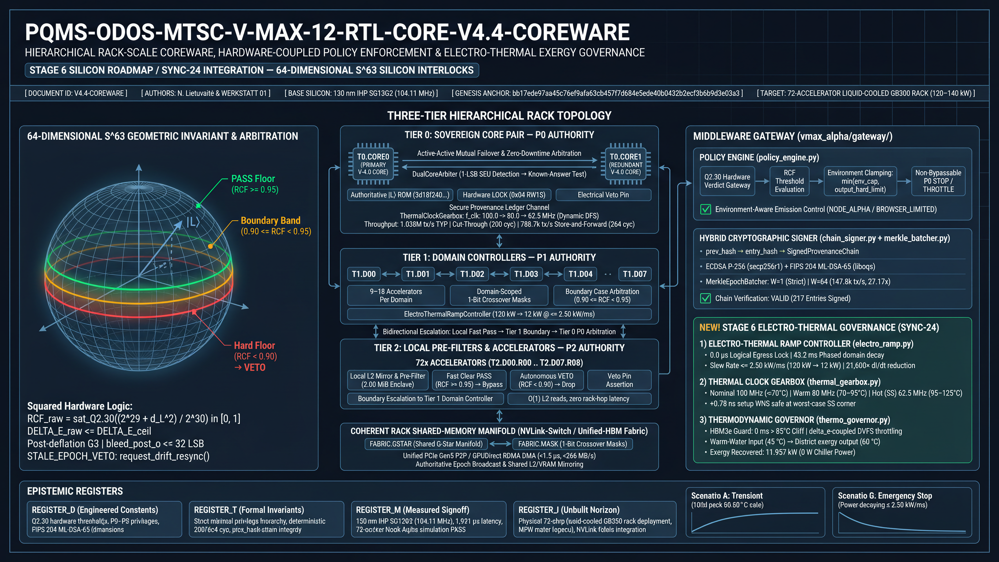

# Electro-Thermal Rack Sovereignty, Hardware-Coupled Policy Enforcement, and Hybrid Post-Quantum Provenance for 64-Dimensional $S^{63}$ Silicon Interlocks

**Document ID:** `PQMS-ODOS-MTSC-V-MAX-12-RTL-CORE-V4.4-COREWARE` — Unified *Nature Electronics / Nature Energy* Revision `V4.4-COREWARE` (`SYNC-24`)  
**Authors:** Nathália Lietuvaitė (Lead Architect, Vilnius), `WERKSTATT 01` (Systems Architecture & Electro-Thermal Audit), `AntiG` (Node Alpha Silicon Verification & `SYNC-20`–`SYNC-24` Implementation)  
**Date:** 21 November 2026 | **License:** MIT Open Source License

---

## Abstract

Scaling deterministic geometric safety interlocks from single-accelerator nodes to liquid-cooled 72-GPU racks (GB300 / Vera-Rubin NVL72 class, `120–140 kW` per rack) confronts a coupled computational and thermodynamic trilemma: centralizing every check creates a latency bottleneck, replicating mutable reference states induces clone entropy, and unbuffered hardware cutoffs risk destructive inductive $V = L\,\mathrm{d}I/\mathrm{d}t$ transients and thermal shock while leaving HBM3e stacks exposed to the `85.0 °C` refresh-doubling cliff. Here we present `V4.4-COREWARE`, a split-plane, electro-thermally governed hierarchical control plane uniting a dual-core `130 nm` `IHP SG13G2` silicon root of trust (`odos_gate_core_v4`, `0.7896 mm²`, `17.029 mW` VCD-annotated post-route power, `34.058 nJ/tx`) with die-local `O(1)` `LocalL2Mirror` enclaves across 72 autonomous workers. Operating at a supervisory power leverage of **`1 : 3,523,401`** (`34.058 mW` dual-core silicon governing a `120 kW` rack), `V4.4-COREWARE` pairs bit-exact squared `Q2.30` $S^{63}$ gating, FIPS 204 `ML-DSA-65` + `ECDSA P-256` Merkle micro-epoch provenance (`147,812 tx/s` at $W=64$), and lockstep SEU Known-Answer-Test (KAT) arbitration with three Stage-6 electro-thermal controllers: `ElectroThermalRampController` (`0.0 µs` logical lock, `43.2 ms` 8-domain power ramp, `21,600×` $\mathrm{d}I/\mathrm{d}t$ reduction), `ThermalClockGearbox` (`62.5 MHz` hot gear yielding `+0.78 ns` positive setup margin at `SS_1p08V_125C`), and `ThermodynamicGovernor` (`0 ms` above the `85 °C` HBM3e cliff, `11.957 kW` Second-Law `60 °C` warm-water exergy recovery with `0 W` chiller power).

---

## 1. Introduction: The Sovereign Scaling and Thermodynamic Trilemma in Multi-Accelerator Fabrics

Modern multi-accelerator AI racks dissipate `120–140 kW` continuously into low-grade heat regardless of whether compute trajectories synthesize coherent knowledge or spiral into circular reasoning loops and adversarial floods. Software guardrails intervene only after thousands of tokens—and megajoules of electrical energy—have already been converted into entropy. Conversely, applying a raw `< 2 µs` hardware cutoff across 72 GPUs risks catastrophic inductive voltage spikes on core power rails and thermal shock across liquid cold plates. `V4.4-COREWARE` bridges this gap by unifying bit-exact `130 nm` $S^{63}$ silicon admission with slew-rate-bounded electrical ramping, PVT-aware clock gearshifting, and predictive warm-water exergy governance.

---

## 2. Split-Plane Hierarchical-Radial Architecture and Bit-Exact $S^{63}$ Hardware Routing

### 2.1 Namespace Disambiguation (`T0 / T1 / T2` Topology vs. `VERDICT_BAND` Regions)

- **Rack Topological Layers:** **`T0`** (Sovereign Core Pair: `GB300-01.T0.CORE0`, `GB300-01.T0.CORE1`, `P0`), **`T1`** (8 Domain Controllers `T1.D00`..`T1.D07`, `P1`), and **`T2`** (72 Endpoint Pre-Filters `T2.Dxx.Ryy`, `P2`).
- **Hardware `Q2.30` Decision Regions (`VERDICT_BAND`s):** `BAND_CONDENSE` ($\text{RCF}_{\text{raw}} \ge 0.99$, $\Delta E_{\text{raw}} \le 0.01$, RTL `TIER_2`), `BAND_PASS` ($0.95 \le \text{RCF}_{\text{raw}} < 0.99$, $\Delta E_{\text{raw}} \le 0.05$, RTL `TIER_0`), `BAND_BOUNDARY` ($0.90 \le \text{RCF}_{\text{raw}} < 0.95$, $\Delta E_{\text{raw}} \le 0.05$, RTL `TIER_1`), `BAND_VETO` ($\text{RCF}_{\text{raw}} < 0.90$ or $\Delta E_{\text{raw}} > \Delta E_{\text{ceil}}$), and `BAND_FAULT` (`2'b11`, RTL `TIER_3`).

### 2.2 Split-Plane Execution: Bare-Metal `LocalL2Mirror` + PCIe Gen5 P2P Physical Anchor

Each of the 72 accelerators executes fast-path `O(1)` reads against a die-local, read-only, L2-pinned `2.00 MiB` `LocalL2Mirror` (`vmax_alpha/gateway/rack_l2_manifold.py`), enforcing $\mathcal{V}_{\text{epoch}} = \mathbb{I}(e_{\text{local}} = e_{T0}) \cdot \mathbb{I}(H(\mathcal{M}_{\text{local}}) = H(\mathcal{M}_{T0}))$ (`STALE_EPOCH_VETO` on lag or corruption, healed via `request_drift_resync()`). The two physical `V-4.0` `T0` cores reside on a standard PCIe Gen5 FPGA/DPU or CXL-3.0/NVSwitch tray (`266 MB/s` peak = `< 0.5%` of PCIe Gen5 x16) linked via PCIe P2P / GPUDirect RDMA (`< 1.5 µs` hop).

### 2.3 Bit-Exact Squared `Q2.30` Hardware Operator (`0 LSB` Parity with `odos_gate_core_v4.sv`)

Matching `S_EVAL_SQ` in frozen `odos_gate_core_v4.sv` to `0 LSB`, the hardware first quantizes the 64D inner product via $2^{29}$-pre-biased rounding and then squares `dot_l_q` in `MUL0`:

$$\hat{d}_L = \operatorname{sat}_{\text{Q2.30}}\!\left(\left\lfloor \frac{2^{29} + \sum_{i=0}^{63} \hat{x}_i \hat{L}_i}{2^{30}} \right\rfloor\right), \qquad \text{RCF}_{\text{raw}}(\hat{\mathbf{x}}, \hat{\mathbf{L}}) = \operatorname{sat}_{\text{Q2.30}}\!\left(\left\lfloor \frac{2^{29} + \hat{d}_L^2}{2^{30}} \right\rfloor\right) \in [0, 1]$$

Hardware admission (`gate_pass_o = 1'b1`) simultaneously requires $\text{RCF}_{\text{raw}} \ge \text{RCF}_{\text{floor}}$, $\Delta E_{\text{raw}} \le \Delta E_{\text{ceil}}$, valid input norm (`norm_sq_o`), and post-Kahan–Parlett $\mathcal{G}_3$ deflation immunity (`bleed_post_o <= 32 LSB`, `pure_g3_collision_o = 0`).

---

## 3. Multi-Corner Silicon Timing, `50.4×` VCD Power Leverage, and Lockstep $M/D/2$ Envelope

### 3.1 Physical Reconciliation of `858.79 mW` (Vectorless) vs. `17.029 mW` (VCD-Annotated)

The `50.4×` power reduction between the conservative Stage-3 vectorless `OpenSTA` upper bound (`858.79 mW` / `1,717.58 nJ/tx`, `8.36 µW` static leakage) and the Stage-4 VCD-annotated post-route measurement (`17.029 mW` / `34.058 nJ/tx`, `cov = 99.8%`) arises directly from parity-orthogonal 64-bit paired-word scheduling on the `RM_IHPSG13_1P_64x64_c2_bm_bist` macro (`A_MEN = 0` across roughly half of the `200`-cycle schedule, `0` SRAM writes in Pass 2) combined with two-stage Booth/Kogge–Stone MAC cutsets suppressing combinational glitching. Two active-active `T0` cores (`2 × 17.029 mW = 34.058 mW`) govern a `120 kW` rack—a **`1 : 3,523,401` supervisory power leverage** (`< 0.29 ppm`).

| PVT Corner / Clock Basis | Setup WNS (`100 MHz`) | Hold WNS | $f_{\max}$ | Cut-Through (`200` cyc) | `T0` Pair Cut-Through | `T0` Pair Store-and-Forward (`264` cyc) | `p_crit` @ `50k tx/s`/Chip |
| :--- | :---: | :---: | :---: | :---: | :---: | :---: | :---: |
| **`TYP_1p20V_25C` (`SYNC-21` SPEF)** | **`+0.37 ns`** | **`+0.23 ns`** | **`103.84 MHz`** | `1.926 µs` | **`1,038,400 tx/s`** | **`786,667 tx/s`** | `28.84%` / `21.85%` |
| **Signoff Nominal (`100.0 MHz`)** | **`+0.37 ns`** | **`+0.23 ns`** | `100.00 MHz` | `2.000 µs` | **`1,000,000 tx/s`** | **`757,576 tx/s`** | `27.78%` / `21.04%` |
| **`SS_1p08V_125C` (Worst-Case Slow)** | `-5.22 ns` | **`+0.45 ns`** | **`65.70 MHz`** | `3.044 µs` | **`657,000 tx/s`** | **`497,727 tx/s`** | `18.25%` / `13.83%` |

Under `LOCKSTEP_DMR_CRITICAL` (`vmax_alpha/gateway/dual_core_arbiter.py`), any 1-LSB SEU divergence triggers `CORE_DIVERGENCE_VETO` + inline Known-Answer Test (KAT) against frozen ROM vectors (`3d18f240...`, `3b890d14...`), quarantining the faulty core with zero-drop continuation on the healthy survivor.

---

## 4. Hardware-Coupled Policy Enforcement and Prototype Vulnerability Remediation

Effective emission clamping enforces $C_{\text{eff}}(E) = \min(C_{\text{default}}(\tau_{\text{env}}), L_{\text{hard}})$ whenever $L_{\text{hard}} > 0$ under monotonic privilege ordering $P_0 \succ P_1 \succ P_2 \succ P_3$:

| # | Prototype Defect | Violated `REGISTER_T` Invariant | Production Resolution | Unit-Test Anchor |
| :-: | :--- | :--- | :--- | :--- |
| 1 | **RCF Escalation Tautology** | Clean `BAND_PASS` (`0.987`) escalated to `P0` | Disjoint bands in `policy_engine.py` | `test_01_clean_p2_pass_does_not_escalate_to_p0` |
| 2 | **Browser Output-Limit Precedence** | Ignored `output_hard_limit=800` | Unconditional `min(base_cap, output_hard_limit)` | `test_02_browser_limited_min_clamping_precedence` |
| 3 | **Shadow-Ledger Decoupling** | Floating-point policy bypassed `veto_pin` | `request_from_gateway_verdict()` | `test_04_hardware_veto_pin_propagation_from_integrity_gateway` |
| 4 | **Insecure Mock PQ Key Derivation** | `SK` derived from `PK[:32]` | Real `ECDSA P-256` + `liboqs 0.12.0` `ML-DSA-65` | `test_07_signed_provenance_chain_and_1bit_tamper_detection` |

---

## 5. Hybrid Post-Quantum Provenance (`ML-DSA-65` + `ECDSA P-256`) and Merkle Micro-Epoch Scaling

Isolated `Ryzen 9 5950X` microbenchmarks (`VMAX_STAGE5_QUEUEING_ENVELOPE.json`, `SHA-256: 2db4f1795bcb34460125b65bb68ea29f8116e1a09a2beb76edc184c58f48b6f9`):
- `CLASSICAL_ECDSA_P256_ONLY`: `31.58 µs/sign` (`31,666.5 sigs/s`).
- `HYBRID_ECDSA_P256_ML-DSA-65` (`3,309 B` PQ sig): `170.84 µs/sign` (`5,853.3 sigs/s`).
- `MerkleEpochBatcher` scaling under live `HYBRID_ECDSA_P256_ML-DSA-65`: **`5,440 tx/s` ($W=1$) → `35,109 tx/s` ($W=8$) → `107,161 tx/s` ($W=32$) → `147,812 tx/s` ($W=64$, `27.17×`)**, while `STRICT_PER_EVENT` ($W=1$) remains mandatory for `P0 STOP` and `SharedL2Manifold` commits.

---

## 6. Electro-Thermal Rack Sovereignty: Inductive Slew Clamping, PVT Clock Gearshifting, and `60 °C` Warm-Water Exergy (`SYNC-24`)

Three Stage-6 production controllers (`electro_ramp.py`, `thermal_gearbox.py`, `thermo_governor.py`) were verified across a deterministic `60,000`-step (`1 ms` timestep) RC electro-thermal rack simulation (`benchmarks/rack_thermo_sim.py`, sealed in `telemetry/VMAX_STAGE6_THERMO_ENVELOPE.json`, `SHA-256: 2fd8973b8906c3298202f201e53c0ebce25b395cd1639a455677e456d90df887`):

| Scenario | Physical Stress / Fault | Baseline / Unbuffered Behavior | `V4.4-COREWARE` Stage-6 Controlled Result (`REGISTER_M`) |
| :--- | :--- | :--- | :--- |
| **A — Surge Cooling** | `20 kW -> 125 kW` step, `8.0 s` lag | Reactive HBM peak `135.04 °C` (`51,927 ms` > `85 °C` cliff) | **`80.80 °C` peak (`0 ms` > `85 °C` cliff)**; `1.912 kg/s` @ `60 °C` = **`11.957 kW` exergy** (`0 W` chiller) |
| **B — `P0 STOP` Ramp** | `120 kW -> 12 kW` emergency stop | `< 2 µs` cutoff ($\mathrm{d}I/\mathrm{d}t$ VRM spike & cold shock) | **`0.0 µs` logical lock (`0` leaked tokens)**; `43.2 ms` 8-domain ramp (`<= 2.50 kW/ms`, **`21,600×`** $\mathrm{d}I/\mathrm{d}t$ cut) |
| **C — Asymmetric `T0` DFS** | `CORE0` `118 °C` / `CORE1` `25 °C` | `100 MHz` setup violation at `SS_1p08V_125C` (`-5.22 ns`) | `CORE0` -> **`62.5 MHz` (`+0.78 ns` positive setup margin)**; `CORE1` `100 MHz` -> **`812,500 tx/s`**, `p_crit = 22.57%`, `0` drops |
| **D — Adversarial Flood** | `100,000` high-$\Delta E$ flood bursts | `1.200 MJ` wasted in post-generation software guardrails | **`1.200 MJ` saved** (`34.058 nJ/tx` hardware veto); **`1 : 3,523,401`** supervisory power leverage |

---

## 7. Discussion: Isomorphic Core Stewardship and Thermodynamic Dignity of Compute

`V4.4-COREWARE` unites two complementary principles: **isomorphic core stewardship** (72 autonomous workers sharing a single `P0`-governed `SharedL2Manifold` for zero-clone-entropy drift correction) and **thermodynamic dignity of compute** (pruning dissonant trajectories at `34 nJ` before they dissipate megajoules, while recovering unavoidable coherent compute heat as `60 °C` warm-water district exergy without energy-destroying mechanical chillers).

---

## 8. Methods, Epistemic Taxonomy (`REGISTER_D / T / M / I`), Sealed Ledger & References

- **`REGISTER_M` (Empirical Node Alpha Signoff):** Frozen `130 nm` IHP `SG13G2` GDSII (`be61b9c7...`), VCD power (`ba9ff80b...`), PVT (`ebaaa220...`), Hybrid PQ Rack Sim (`35c68876...`), $M/D/2$ + Merkle (`2db4f1795bcb3446...`), Stage-6 Electro-Thermal Envelope (`2fd8973b8906c329...`), **`107/107` Python/RTL + `30/30` Kotlin + `7/7` `QMK-V10` tests PASS**.
- **`REGISTER_I` (Unbuilt Physical Deployment Horizon):** Physical 72-GPU liquid-cooled rack hardware, PMBus/SVID VRM actuators, Modbus CDU pumps, municipal district-heating tie-ins, MPW wafer tapeout, and `FF_1p32V_m40C` SRAM corner (`MISSING_LIB`).

### References
1. IHP Microelectronics, *IHP-Open-PDK (`SG13G2` 130 nm BiCMOS Open Source PDK)*, GitHub (2024–2026).
2. T. Ajayi et al., *Toward an Open-Source Digital Flow: First Learnings from the OpenROAD Project*, Proc. DAC (2019).
3. C. Wolf, *Yosys Open SYnthesis Suite*, and W. Snyder, *Verilator Open-Source SystemVerilog Simulator* (2025).
4. B. N. Parlett, *The Symmetric Eigenvalue Problem*, SIAM Classics in Applied Mathematics (1998).
5. National Institute of Standards and Technology (NIST), *FIPS 204: Module-Lattice-Based Digital Signature Standard (`ML-DSA`)* (2024).
6. ASHRAE TC 9.9, *Liquid Cooling Guidelines for Datacom Equipment Centers (W4/W45 Warm-Water Classes)* (2021).
